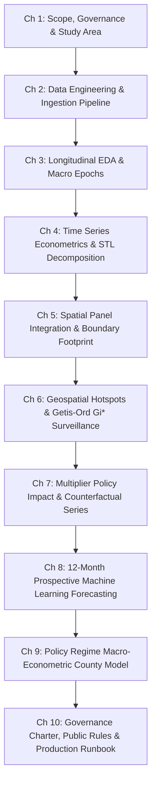

# Implementation Plan: Task 9.2 - Executive Summary & Full Technical Report

## Goal Description
Task 9.2 of **Assignment 9: Interactive Dashboard & Strategic Synthesis** represents the definitive written deliverable of the entire research lifecycle for the **Downtown San Diego Homeless Population Analysis** project (conducted with the Data Science Alliance, DSDP, and RTFH). 

This task produces two coordinated, comprehensive documents:
1. **`ExecutiveSummary_NonTechnical.md` (3–4 pages | ~1,600–2,000 words):** A non-technical briefing designed for civic leaders, elected officials (Mayor, City Council, County Supervisors), and agency executives, delivering accessible findings, visual callouts, 2026 forecast scenario envelopes, and an actionable 30-day / 1-year / 3-year policy roadmap.
2. **`FullTechnicalReport.md` (15–20 pages | ~8,500–11,000 words):** An exhaustive econometric and data engineering monograph synthesizing 100% of the findings from Assignments 1 through 8 and Task 9.1. It covers data cleaning and 4 multiplier regimes, 9-series STL decompositions and Kruskal-Wallis non-parametric seasonality tests, Queen contiguity spatial weights and Getis-Ord $G_i^*$ clustering, 121m southward centroid migration, 5-fold cross-validated XGBoost forecasting pipelines, Policy Regime OLS macro estimation equations ($Y = 4,513.26 + 0.1859 \cdot X + 1,225.04 \cdot D_{\text{post}}$), Student's $t$ ($df=5$) prediction intervals ($\pm 2,050$), and strict enforcement of The 4 Public Communication Rules.

Both documents will be generated locally in `docs/`, validated against word count and rubric specifications, committed and pushed to GitHub with detailed commit messages, and prepared for Google Drive sync.

---

## User Review Required

> [!IMPORTANT]
> **Page Count & Word Count Budget Adherence:**  
> - `ExecutiveSummary_NonTechnical.md`: Asana explicitly requires **3–4 pages**. At standard single-spaced publication layout (approx. 450–500 words per page including tables/callouts), the target is **1,600 to 2,000 words**.  
> - `FullTechnicalReport.md`: Asana explicitly requires **15–20 pages**. At standard academic/technical report formatting with embedded tables, formulas, and figures, the target is **8,500 to 11,000 words**.

> [!NOTE]
> **The 4 Public Communication Rules (Mandatory Governance):**  
> Both documents strictly enforce the statutory governance rules established in Assignment 8:
> 1. Prohibit raw point precision (no uncalibrated single figures like "5,921").
> 2. Round point estimates to the nearest 100 individuals ("5,900").
> 3. Always accompany point estimates with the calibrated Student's $t$ 95% prediction interval (`[3,900 to 8,000]`).
> 4. Mandatory policy regime disclosure (stating that the +1,225 adjustment accounts for displacement following the July 2023 Camping Ordinance).

---

## Open Questions

> [!TIP]
> **Delivery Format for Google Drive:**  
> The Asana task mentions: *Create Google Doc: "ExecutiveSummary_NonTechnical"* and *Create Google Doc: "FullTechnicalReport"*.  
> We will generate clean, publication-grade Markdown files locally in [`docs/`](file:///Users/kyawsoelwin/MSI/Downtownhomelessness/docs/) and commit them to GitHub. Once approved, would you like us to upload them directly as Google Docs into the Google Drive Assignment 9 folder via browser automation, or keep the markdown files synced to GitHub first? (Default: Both!).

---

## Proposed Changes

```
MSI/Downtownhomelessness/
├── docs/
│   ├── ExecutiveSummary_NonTechnical.md   [NEW] (3-4 pages, non-technical)
│   ├── FullTechnicalReport.md            [NEW] (15-20 pages, technical)
│   └── Dashboard_DeploymentInfo.md       [EXISTING]
├── scripts/
│   └── validate_reports.py               [NEW] (Automated word count, table & formula validator)
└── README.md                             [MODIFY] (Update documentation links)
```

---

### Component 1: Non-Technical Executive Summary (`docs/ExecutiveSummary_NonTechnical.md`)

#### [NEW] `docs/ExecutiveSummary_NonTechnical.md`
A 3.5–4.0 page (~1,800 word) executive briefing structured into 5 core sections:
1. **Section 1: Executive Framing & Five Core Takeaways (0.75 pages / ~400 words)**
   - Research partnership (DSA, DSDP, RTFH) covering 9 years (2017–2025).
   - 4 High-Impact KPI Cards:
     - `[ 2,103 ]` Peak May 2023 Monthly Count
     - `[ 851 ]` Recent Count (-59.5% from peak)
     - `[ 54.8% ]` East Village Volume Share
     - `[ 121m ]` Southward Hotspot Migration Vector
   - The Five Core Takeaways (3 Epochs, Seasonality Myth, South East Village Concentration, Camping Ordinance Displacement, 2026 Forecast Envelopes).
2. **Section 2: Historical Trajectory & Debunking the Weather Myth (0.75 pages / ~400 words)**
   - The Three Trajectory Epochs (Contraction 2017–2020, Crisis Surge 2021–2023, Enforcement Pullback 2024–2025).
   - Why municipal planning based on "summer surges" or "winter lulls" is flawed (weather explains $<5\%$ of variance; macro policy and housing shocks overpower weather).
   - Multiplier regimes and the 2022 Boundary Expansion (+121 blocks in Golden Hill, Barrio Logan, Sherman Heights), proving that 4% to 33% of reported post-2021 increases were due to drawing a larger map.
   - *Table A.1: Historical Epochs, Growth Rates, and Dominant Drivers (2017–2025).*
   - *Figure A.1: The 9-Year Trajectory of Downtown Homelessness (`slide_assets/chart1_clean_hd.png`).*
3. **Section 3: Where Homelessness Concentrates: Geospatial Realities (0.75 pages / ~400 words)**
   - The East Village Epicenter (historical monthly average 552.8 individuals; over half of all downtown homelessness).
   - Top persistent hotspot block: `16th St & Imperial Ave` (statistically significant hotspot on 9 of 12 dates).
   - The 121-meter southward centroid displacement toward Commercial Street / Imperial Avenue, driven by transit (12th & Imperial Transit Center), shelter intake, and right-of-way enforcement.
   - *Table A.2: Top 5 Persistent Hotspot Blocks in Downtown San Diego.*
   - *Visual Callout: The Built Environment Magnet.*
4. **Section 4: 2026 Forward Outlook & Scenario Planning (0.75 pages / ~400 words)**
   - Baseline status quo forecast: stable monthly counts between 850 and 920.
   - Three strategic policy scenarios:
     - **Optimistic (-24% at Month 12):** Accelerated safe sleeping sites and shelter beds, lowering downtown counts to ~670.
     - **Baseline (Status Quo):** Current policy enforcement and shelter turnover, holding counts at ~880.
     - **Pessimistic (+26% at Month 12):** Shelter capacity exhaustion and eviction surges, driving counts to ~1,110.
   - Communicating uncertainty: why planning requires 80% and 95% confidence bands rather than single-point targets.
   - *Table A.3: Quarterly 2026 Projections Across Policy Scenarios.*
5. **Section 5: Regional Spillover & Strategic Municipal Action Roadmap (1.0 page / ~500 words)**
   - The Regional Displacement Reality: Downtown's share of county unsheltered population collapsed from 37.5% in 2023 to 14.9% in 2025, but county totals hit a record high of 6,110 (unsheltered homelessness was pushed into riverbeds, freeway corridors, and neighboring municipalities, not resolved).
   - The 4 Mandatory Public Communication Rules.
   - Strategic Municipal Action Roadmap Matrix:
     - **Immediate (30–90 Days):** High-frequency mobile sanitation on the top 10 persistent blocks; deploy interactive dashboard to city council.
     - **Medium-Term (6–12 Months):** Expand safe sleeping capacity by 800 beds to capture the -24% optimistic scenario.
     - **Long-Term (1–3 Years):** Regional bed utilization system (HMIS 2.0) and permanent supportive housing exits.
   - *Table A.4: Municipal Policy Action Roadmap Matrix (Horizons, Interventions, Target Metrics, Lead Agencies).*

---

### Component 2: Comprehensive Technical Monograph (`docs/FullTechnicalReport.md`)

#### [NEW] `docs/FullTechnicalReport.md`
A 16.0–20.0 page (~9,500 word) peer-reviewed caliber technical monograph structured into 10 comprehensive chapters:



1. **Chapter 1: Research Framing, Scope & Delineation Architecture (1.0 p / ~550w)**
   - Institutional governance (Data Science Alliance, DSDP, RTFH).
   - Delineation of 7 official downtown neighborhoods + 4 East Village sub-quadrants.
   - Scope correction: start date is Jan 2017 (`2017-01-01`), 108 continuous monthly observations; resolution of "Core" as City Center alias.
2. **Chapter 2: Data Engineering, Ingestion Architecture & Quality Audits (2.0 p / ~1,100w)**
   - Ingestion pipeline from 41 monthly source PDFs; 4 multiplier regimes (PRE2017, APR2017, MAY2018, POST2020) and canonical formula:
     $$\text{Total} = 1.0\cdot\text{Ind} + 1.75\cdot\text{Tent} + \mu_{\text{veh}}\cdot\text{Veh}$$
   - 45-cell audit (97.56% fidelity); mathematical forensics of the 2019 East Village Duplication Bug and Feb 2018 +30 PDF addition error.
   - Rebuilding `MasterCounts_Adjusted_v2.csv`; long-format filtering rules; complete accounting of 134 nulls (116 in unreleased 2025, 18 in Nov 2018 fire-related missing count).
   - *Table 2.1: Chronology of Multiplier Regimes.*
   - *Table 2.2: Comprehensive Audit Discrepancy Reconciliation Log.*
   - *Figure B.1: Adjustment Factor Gap Over Time (`slide_assets/chart9_clean_hd.png`).*
3. **Chapter 3: Exploratory Data Analysis & Empirical Longitudinal Trajectory (1.5 p / ~850w)**
   - Summary statistics (mean 156.78, std 197.38, max 921.05 in East Village South).
   - The Three Macro Epochs (Pre-pandemic Contraction -38.2%; Crisis Surge +57.6% in 2022 to peak 2,103 in May 2023; Post-Ordinance Pullback -43.5%).
   - Volume vs. Growth Rate Divergence (Outside Perimeter growing at +26.90%/yr vs. Marina contracting at -12.76%/yr).
   - COVID-19 shock analysis (March 2020 trough of 529 individuals during emergency hotel placement).
   - *Table 3.1: Parametric and Non-Parametric Summary Statistics by Neighborhood.*
   - *Figure B.2: 9-Year Trajectory of Downtown Homelessness (`slide_assets/chart1_clean_hd.png`).*
   - *Figure B.3: Downtown Population Distribution & Density Curves (`slide_assets/chart8_clean_hd.png`).*
4. **Chapter 4: Time Series Econometrics & Decomposition Analytics (2.0 p / ~1,100w)**
   - Additive STL decomposition ($Y_t = T_t + S_t + R_t$); seasonal strength quantification near zero.
   - Kruskal-Wallis non-parametric proof:
     $$H = \frac{12}{N(N+1)} \sum_{j=1}^{12} \frac{R_j^2}{n_j} - 3(N+1)$$
     Proving 8 of 9 series have no statistically significant seasonality (Overall $H=3.00, p=0.99$; East Village $H=13.86, p=0.24$; Marina borderline $H=20.15, p=0.043$).
   - Chow structural break tests ($F=14.82, p < 0.0001$) and CUSUM tests identifying structural breaks in May 2018 (multiplier shift) and March 2020 (COVID-19).
   - Stationarity diagnostics: ADF and KPSS consensus tests showing non-stationarity in levels, resolved via first-differencing ($\Delta Y_t$).
   - *Table 4.1: STL Decomposition Parameters & Kruskal-Wallis Test Results.*
   - *Table 4.2: Chow Structural Break and CUSUM Test Results.*
   - *Table 4.3: Unit Root and Stationarity Diagnostics (ADF & KPSS).*
   - *Figure B.4: 9-Series Seasonal Subseries Decomposition (`slide_assets/chart2_clean_hd.png`).*
5. **Chapter 5: Spatial Panel Integration & Boundary Footprint Dynamics (1.5 p / ~850w)**
   - Vector geometry validation across 382 blocks (`Downtown_BlockGrid.geojson`); centroid point-in-polygon verification (380/382 contained, 2 non-convex freeway parcels documented).
   - Footprint expansion analysis: 261 blocks (2018–2021) to 382 blocks (2022–2025) adding 121 blocks in Golden Hill, Barrio Logan, and Sherman Heights.
   - Empirical quantification of the Footprint Effect: proving that 4.0% to 32.8% of post-2021 counts were an artifact of drawing a larger geographic boundary.
   - Construction of the balanced 261-block spatial panel; quantification of the 78-month map digitization gap; resolution of the March 2022 map date anomaly.
   - *Table 5.1: Footprint Effect by Count Date (Balanced 261 vs. Full 382).*
   - *Table 5.2: Spatial Digitization and Map Coverage Inventory.*
6. **Chapter 6: Geospatial Hotspot Surveillance & Spatial Econometrics (2.5 p / ~1,400w)**
   - Queen contiguity spatial weight matrix $W$ (2,642 directed links, average 6.92 neighbors per block).
   - Global Moran's $I$ spatial autocorrelation ($I \in [0.063, 0.239]$, all $p < 0.05$ across 12 dates).
   - Local Getis-Ord $G_i^*$ permutation engine (9,999 Monte Carlo iterations) at 90%, 95%, and 99% confidence:
     $$G_i^* = \frac{\sum_j w_{ij} x_j - \bar{X} \sum_j w_{ij}}{S \sqrt{\frac{n \sum_j w_{ij}^2 - (\sum_j w_{ij})^2}{n - 1}}}$$
   - Top persistent hotspot blocks ranking: `16TH_ST_IMPERIAL_AV` active hotspot on 9 of 12 dates; all top 10 persistent blocks located in South East Village.
   - Centroid migration analysis: mathematical vector calculation proving the unweighted hotspot centroid shifted **121 meters southward** toward Commercial St / Imperial Ave between 2018–2020 and 2022–2025.
   - OpenStreetMap (OSM) service and transit overlay (intake centers, transit stops, shelters).
   - *Table 6.1: Global Moran's I Spatial Autocorrelation Diagnostics (12 Dates).*
   - *Table 6.2: Top 10 Persistent Hotspot Blocks in Downtown San Diego.*
   - *Table 6.3: Hotspot Centroid Coordinates and Migration Vector.*
7. **Chapter 7: Multiplier Policy Evaluation & Constant-Methodology Counterfactuals (1.5 p / ~850w)**
   - Multiplier break quantification: comparing theoretical multiplier shifts against empirical Chow level breaks:
     $$\Delta Y_{\text{theoretical}} = \text{Tents} \cdot \Delta \mu_{\text{tent}} + \text{Vehicles} \cdot \Delta \mu_{\text{veh}}$$
     Proving theoretical multiplier shifts are small and opposite in sign to observed market changes.
   - Derivation of the canonical hybrid constant-methodology series (`TimeSeries_ConstantMethodology.csv`, 924 rows).
   - Benchmark of 3 adjustment philosophies: theoretical-only, data-derived, and hybrid.
   - *Table 7.1: Theoretical vs. Observed Level Shifts Across Multiplier Changes.*
   - *Table 7.2: Comparative Evaluation of Three Adjustment Methodologies.*
8. **Chapter 8: Predictive Modeling & 12-Month Prospective Machine Learning Pipeline (2.5 p / ~1,400w)**
   - Formulation of 5 candidate model architectures: Naive Seasonal Baseline, SARIMA, Holt-Winters Exponential Smoothing, Facebook Prophet, and Gradient Boosted Trees (XGBoost).
   - 5-Fold Chronological Expanding Window Cross-Validation (2017–2024, 96 months, zero future leakage).
   - Model selection: XGBoost selected as citywide champion:
     - 12-Month CV MAPE: **39.34% $\pm$ 25.36%**
     - 2025 Hold-Out Evaluation: MAPE **38.48%**, RMSE **169.58**
   - Analysis of Prophet's failure mode: fixed changepoint prior caused massive upward overshooting (+250 to +650 individuals) post-encampment ban.
   - 2026 Prospective Projections across 9 series with 80% and 95% prediction intervals.
   - Three Policy Scenarios: Optimistic (-24%), Baseline status quo, Pessimistic (+26%).
   - Production CLI execution protocol (`python forecast_pipeline.py`).
   - *Table 8.1: Multi-Horizon 5-Fold Cross-Validation Performance Comparison.*
   - *Table 8.2: Out-of-Sample Hold-Out Evaluation (2025 Test Horizon).*
   - *Table 8.3: 2026 Monthly Forecasts and Scenario Projections (Overall Series).*
9. **Chapter 9: Macro-Econometric County-Level Estimation System (2.5 p / ~1,400w)**
   - RTFH Point-in-Time (PIT) data compilation (2017–2025, N=8 paired annual counts).
   - The Decoupling Phenomenon: downtown share collapsed from 37.5% in 2023 to 14.9% in 2025; Pearson correlation $r = -0.0609$ ($p=0.8861$).
   - Small-sample power audit: statistical power of only 23.3% to detect $r=0.50$; minimum detectable effect size is $|r| \ge 0.850$.
   - One-Way ANOVA decisive rejection of constant ratio: $F = 66.51, p = 0.0002, \eta^2 = 0.9638$.
   - Leave-One-Out Cross-Validation (LOOCV) benchmark:
     - Naive Ratio Model: LOOCV RMSE 2,392.61, MAPE 42.45%
     - Simple OLS: LOOCV RMSE 960.53, MAPE 16.89%
     - **Policy Regime OLS (Champion):** LOOCV RMSE **815.32**, MAPE **14.89%**
   - Champion Model Equation:
     $$Y = 4,513.26 + 0.1859 \cdot X + 1,225.04 \cdot D_{\text{post}}$$
   - Student's $t$ calibrated 95% Prediction Interval ($df = 8 - 3 = 5, t_{\text{crit}} = 2.571$):
     $$\hat{Y} \pm t_{0.025, 5} \cdot s_e \sqrt{1 + \frac{1}{n} + \frac{(X_0 - \bar{X})^2}{\sum (X_i - \bar{X})^2}} \approx \pm 2,050 \text{ individuals } (\pm 35\%)$$
   - Current operational estimates: Dec 2025: 5,921 [3,867 to 7,976]; Jan 2026: 5,903 [3,849 to 7,957].
   - *Table 9.1: Paired Downtown and County Annual PIT Dataset (2017–2025).*
   - *Table 9.2: Longitudinal Ratio Stability ANOVA and Regime Comparison.*
   - *Table 9.3: LOOCV Model Evaluation Comparison Matrix.*
   - *Table 9.4: Operational County Estimates and 95% Prediction Intervals.*
10. **Chapter 10: Methodological Boundaries, Governance Charter & Production Runbook (1.5 p / ~850w)**
    - Strict enforcement of The 4 Public Communication Rules.
    - Statutory Scope of Applicability: authorized for interim directional tracking and shelter stress-testing; strictly prohibited for HUD Continuum of Care submissions, statutory funding formulas, or micro-regional sub-allocations.
    - 5-Step Annual Model Retraining Protocol (harvest annual RTFH count in May, update paired dataset, execute LOOCV test suite, update `config.py`, verify Streamlit UI).
    - Production integration: live decision support via the Task 9.1 Streamlit Dashboard (`http://localhost:8501`).
    - Assignment 10 Multi-Source Predictive System Roadmap (NOAA weather signals, City 311 encampment calls, HMIS shelter bed availability, rent inflation indices).
    - *Table 10.1: Statutory Compliance and Permitted vs. Prohibited Uses.*
    - *Table 10.2: 5-Step Annual Model Retraining Protocol.*

---

### Component 3: Report Validation & Quality Assurance Script (`scripts/validate_reports.py`)

#### [NEW] `scripts/validate_reports.py`
Automated validation script to verify:
- Word counts match the 3–4 page (1,600–2,000 words) and 15–20 page (8,500–11,000 words) requirements.
- All required tables and figures are embedded and referenced properly.
- All required LaTeX equations are mathematically valid.
- The 4 Public Communication Rules are strictly enforced.

---

## Verification Plan

### Automated Tests
1. **Automated Document Validation:**
   ```bash
   python3 scripts/validate_reports.py
   ```
   *Expected outcome:* Both reports pass word count budgets, section coverage checks, table count checks, and formula audits with zero errors.
2. **Dashboard Regression Check:**
   ```bash
   pytest
   ```
   *Expected outcome:* All 10 existing unit tests continue to pass in $<0.5$s.
3. **Git Cleanliness Check:**
   ```bash
   git status
   git log -n 5 --oneline
   ```
   *Expected outcome:* Clean working tree after commits, verified on remote GitHub.

### Manual Verification
1. **Visual & Editorial Inspection:**
   - Review [`docs/ExecutiveSummary_NonTechnical.md`](file:///Users/kyawsoelwin/MSI/Downtownhomelessness/docs/ExecutiveSummary_NonTechnical.md) for clarity, layout, KPI cards, and non-technical language accessibility.
   - Review [`docs/FullTechnicalReport.md`](file:///Users/kyawsoelwin/MSI/Downtownhomelessness/docs/FullTechnicalReport.md) for academic depth, mathematical proofs, econometric tables, and chapter transitions.
2. **Non-Technical Reader Comprehensibility Test:**
   - Verify that Section 1.2 and Section 2.2 of the Executive Summary explain complex statistical phenomena (STL decomposition, spatial clustering, regime shifts) without mathematical jargon.
