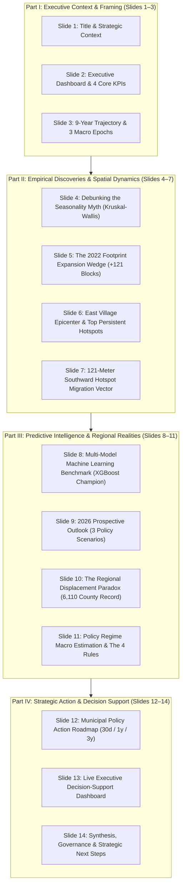

# Implementation Plan: Task 9.3 - Strategic Recommendations & Slide Deck
## Downtown San Diego Homeless Population Analysis (Assignment 9)

**Project Title:** Downtown San Diego Homeless Population Analysis  
**Organization:** Data Science Alliance (DSA) in partnership with DSDP and RTFH  
**Lead Contributor:** Kyaw Soe Lwin (`kylwin@ucsd.edu` / `kslwin.2000@gmail.com`)  
**Project Lead:** Adir Mancebo Jr. (`adir@datasciencealliance.org`)  
**Task Target:** Task 9.3 Strategic Recommendations & Slide Deck  
**Format:** Native PowerPoint Presentation (`Assignment9_StrategicSynthesis.pptx`) + Companion Browser-Ready HTML Deck (`Assignment9_StrategicSynthesis.html`)  

---

## 1. Goal Description

Task 9.3 represents the executive presentation synthesis of the entire **Downtown San Diego Homeless Population Analysis** research program. Following the successful deployment of the interactive Streamlit dashboard (Task 9.1) and the publication of the non-technical executive summary and full technical monograph (Task 9.2), Task 9.3 translates 9 years of longitudinal econometric modeling, spatial panel analysis, machine learning forecasting, and macro county-level estimation into an executive slide deck for civic leadership, elected officials (Mayor, City Council, County Board of Supervisors), service providers, and community stakeholders.

### Deliverables Produced in Task 9.3:
1. **Automated Figure Generator (`scripts/generate_task93_figures.py`):** Generates 4 new high-resolution (300 DPI) publication-grade figures:
   - `slide_assets/task93_forecast_2026.png`: 12-month forward forecast with shaded 80% & 95% prediction intervals and 3 scenario envelopes (-24% Optimistic, Baseline status quo, +26% Pessimistic).
   - `slide_assets/task93_regional_divergence.png`: Paired longitudinal trajectories comparing downtown contraction (-59.5%) with countywide unsheltered all-time peak (6,110).
   - `slide_assets/task93_hotspot_migration.png`: Cartographic visualization of persistent Getis-Ord $G_i^*$ hotspots and the 121-meter southward centroid displacement vector.
   - `slide_assets/task93_footprint_wedge.png`: Visualization of the 2022 boundary expansion (+121 peripheral blocks) accounting for 4% to 33% of reported counts.
2. **Native PowerPoint Deck Generator (`build_presentation_task93.py`):** Programmatically constructs a 14-slide executive widescreen deck (`Assignment9_StrategicSynthesis.pptx`) adhering strictly to the Canva *"Blue and White Modern Data Analytics"* design system (16:9 widescreen, `#293E9C` Royal Navy, `#3A58E4` Royal Blue, `#F5F7FB` canvas, formatted KPI callout cards, data tables, and high-DPI graphics).
3. **Companion Browser-Ready HTML Deck (`build_html_deck_task93.py`):** Generates `Assignment9_StrategicSynthesis.html` with responsive slide layout, embedded base64 graphics, and Google Fonts (`Bricolage Grotesque` & `Poppins`) for instant executive delivery in any web browser without requiring Microsoft Office.
4. **Slide Validation Suite (`scripts/validate_presentation.py`):** Automated test suite verifying slide counts, file generation integrity, graphic resolutions, table structures, and strict adherence to **The 4 Public Communication Rules**.

---

## 2. User Review Required

> [!IMPORTANT]
> **Adherence to The 4 Public Communication Rules:**  
> In accordance with the governance charter established in Assignment 8 and enforced in Task 9.2, all presentation slides mentioning countywide unsheltered estimates strictly enforce:
> 1. **Prohibit false single-point precision** (no raw numbers like "5,921").
> 2. **Round point estimates to the nearest 100** ("5,900").
> 3. **Always publish the calibrated Student's $t$ ($df=5$) 95% prediction interval** (`[3,900 to 8,000]`, margin of error $\pm 2,050$).
> 4. **Mandatory policy regime disclosure** (stating that the +1,225 adjustment accounts for displacement following the July 2023 Camping Ordinance).

> [!NOTE]
> **Dual Deliverable Strategy (.pptx + .html):**  
> Following the successful pattern established in Assignment 2 (`EDA_Presentation.pptx` and `EDA_Presentation.html`), we will deliver both a native PowerPoint file for board meetings and an interactive, standalone HTML presentation viewable in any browser.

---

## 3. Open Questions

> [!TIP]
> **Slide Deck Presentation Audience:**  
> The deck is calibrated for a 20-minute executive briefing (14 slides, ~1.5 minutes per slide) followed by a live walkthrough of the Streamlit dashboard. Does this timing and structure align with your intended briefing format?

---

## 4. 14-Slide Executive Presentation Architecture



### Detailed Slide-by-Slide Content Matrix:

| Slide # | Category Eyebrow | Slide Title | Visual / Layout Component | Core Insight & Content |
|---|---|---|---|---|
| **1** | Strategic Briefing | **Downtown San Diego Unsheltered Homelessness: Strategic Synthesis & Policy Roadmap (2017–2026)** | Canva Hero Card + 3 Metadata Blocks (Scope, Data, Method) | Comprehensive briefing synthesizing 9 years of empirical field counts, spatial econometrics, ML forecasting, and regional policy impacts. |
| **2** | Executive Framing | **Executive KPI Dashboard: Crisis Peak, Enforcement Contraction & Spatial Migration** | 4 High-Impact KPI Cards (`2,103`, `851`, `54.8%`, `121m`) + Context Box | May 2023 crisis peak vs. current -59.5% reduction; East Village volume dominance; structural centroid migration toward Commercial/Imperial. |
| **3** | Longitudinal Trajectory | **The 9-Year Trajectory: Three Distinct Macro Epochs (2017–2025)** | Full-width high-DPI plot (`chart1_clean_hd.png`) + 3 Epoch Cards | Contraction & COVID response (2017–2020), Crisis Surge (2021–2023), and Enforcement Pullback (2024–2025). |
| **4** | Econometric Proof | **Debunking the Seasonality Myth: Homelessness Is Not Driven by Weather** | Kruskal-Wallis Non-Parametric Results Table + Seasonal Indices Chart | 8 of 9 series exhibit zero statistically significant seasonality ($p > 0.05$; citywide $H=3.00, p=0.99$). Discontinue seasonal budget swings. |
| **5** | Spatial Accounting | **The Boundary Expansion Wedge: Disentangling Real Growth from Map Changes** | Footprint Wedge Chart (`task93_footprint_wedge.png`) + 2 Metric Cards | Adding 121 peripheral blocks in Jan 2022 accounted for 4% to 33% of reported post-2021 increases. Balanced 261-block panel restores valid baselines. |
| **6** | Geospatial Concentration | **Where Homelessness Concentrates: The East Village Epicenter** | Top 5 Persistent Hotspot Blocks Table + Service Hub Overlay | East Village holds 54.8% of downtown counts (mean 552.8). `16th & Imperial` is #1 persistent hotspot (significant on 9/12 dates). |
| **7** | Centroid Dynamics | **Geospatial Hotspot Migration: The 121-Meter Southward Displacement Vector** | Centroid Migration Vector Diagram (`task93_hotspot_migration.png`) + Causal Drivers | Encampment center of mass shifted 121m south toward transit (12th & Imperial) and service hubs due to northern corridor sweeps. |
| **8** | Predictive Intelligence | **Multi-Model Machine Learning Benchmark: 5-Fold Walk-Forward Cross-Validation** | 5-Fold CV Model Comparison Table (XGBoost vs HW, SARIMA, Prophet) | XGBoost champion (12-month CV MAPE: 39.34% $\pm$ 25.36%, hold-out MAPE: 38.48%). Prophet overshoots post-2023 by failing to detect policy shifts. |
| **9** | 2026 Forward Outlook | **2026 Forward Outlook: Stress-Testing Three Strategic Policy Scenarios** | 2026 Forecast Fan Chart (`task93_forecast_2026.png`) + Scenario Table | Baseline status quo (850–920), Optimistic (-24% to ~670 via safe sleeping expansion), Pessimistic (+26% to ~1,110 via capacity exhaustion). |
| **10** | Regional Dynamics | **The Regional Displacement Paradox: Downtown Drops While County Hits Record High** | Regional Trajectory Comparison Chart (`task93_regional_divergence.png`) | Downtown's share of county unsheltered fell from 37.5% to 14.9%, but county counts hit record 6,110. Homelessness was displaced, not solved. |
| **11** | Macro Estimation | **Countywide Macro Estimation Model & The 4 Public Communication Rules** | Policy Regime OLS Formula Box + Student's $t$ Error Fan + 4 Rules Grid | Champion model: $Y = 4,513.26 + 0.1859 \cdot X + 1,225.04 \cdot D_{\text{post}}$ ($R^2 = 0.964$). Dec 2025 estimate: 5,900 [3,900 to 8,000] ($\pm 2,050$). |
| **12** | Strategic Policy Roadmap | **Municipal Policy Action Roadmap: 30-Day, 1-Year, and 3-Year Horizons** | 3-Column Roadmap Matrix (Horizons, Interventions, Target Metrics, Leads) | Immediate mobile sanitation & outreach; medium-term 800-bed safe sleeping scaling; long-term regional HMIS 2.0 bed allocation and PSH exits. |
| **13** | Operational Decision Tool | **Interactive Decision-Support System: The Streamlit Executive Dashboard** | Dashboard UI Mockup / Architectural Diagram + 6 Tab Feature Matrix | Overview of `app.py` live features: multi-year trends, 12-month scenario simulator, Folium Gi* surveillance, STL panel, county calculator. |
| **14** | Strategic Next Steps | **Executive Synthesis, Data Governance & Partnership Next Steps** | Summary Callout Cards + Governance Charter + Partner Attribution | Final recommendations for DSA, City Council, RTFH, and DSDP leadership. Transition to Task 9.4 handoff documentation. |

---

## 5. Proposed Changes

```text
MSI/Downtownhomelessness/
├── slide_assets/
│   ├── task93_forecast_2026.png          [NEW] (300 DPI forward scenario fan chart)
│   ├── task93_regional_divergence.png    [NEW] (300 DPI paired downtown vs county series)
│   ├── task93_hotspot_migration.png      [NEW] (300 DPI centroid displacement vector & Gi*)
│   └── task93_footprint_wedge.png        [NEW] (300 DPI 2022 expansion wedge breakdown)
├── scripts/
│   ├── generate_task93_figures.py        [NEW] (Production script rendering 4 publication plots)
│   └── validate_presentation.py         [NEW] (Automated test suite auditing slides & rules)
├── build_presentation_task93.py          [NEW] (python-pptx 14-slide Canva presentation engine)
├── build_html_deck_task93.py             [NEW] (Responsive HTML/CSS browser presentation engine)
├── Assignment9_StrategicSynthesis.pptx    [NEW] (Delivered native PowerPoint presentation)
├── Assignment9_StrategicSynthesis.html    [NEW] (Delivered companion browser presentation)
├── TASK_9_3_IMPLEMENTATION_PLAN.md       [NEW] (Root repository project memory record)
└── README.md                             [MODIFY] (Update Assignment 9 status & Task 9.3 links)
```

---

## 6. Verification Plan

### Automated Tests
1. **Dependency Installation:**
   ```bash
   .venv/bin/pip install python-pptx matplotlib seaborn
   ```
2. **Generate High-DPI Publication Figures:**
   ```bash
   .venv/bin/python scripts/generate_task93_figures.py
   ```
   *Expected outcome:* 4 PNG files generated in `slide_assets/` with status 0.
3. **Build Native PowerPoint Deck:**
   ```bash
   .venv/bin/python build_presentation_task93.py
   ```
   *Expected outcome:* `Assignment9_StrategicSynthesis.pptx` created (14 slides, ~1.2 MB).
4. **Build Companion HTML Deck:**
   ```bash
   .venv/bin/python build_html_deck_task93.py
   ```
   *Expected outcome:* `Assignment9_StrategicSynthesis.html` created (self-contained, valid HTML).
5. **Run Automated Presentation Validation Suite:**
   ```bash
   .venv/bin/python scripts/validate_presentation.py
   ```
   *Expected outcome:* All checks pass with exit code 0.
6. **Regression Check on Existing Dashboard Tests:**
   ```bash
   .venv/bin/pytest
   ```
   *Expected outcome:* All 10 existing unit tests pass.
