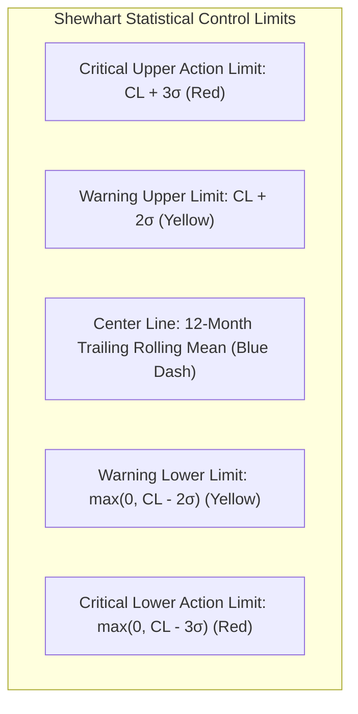
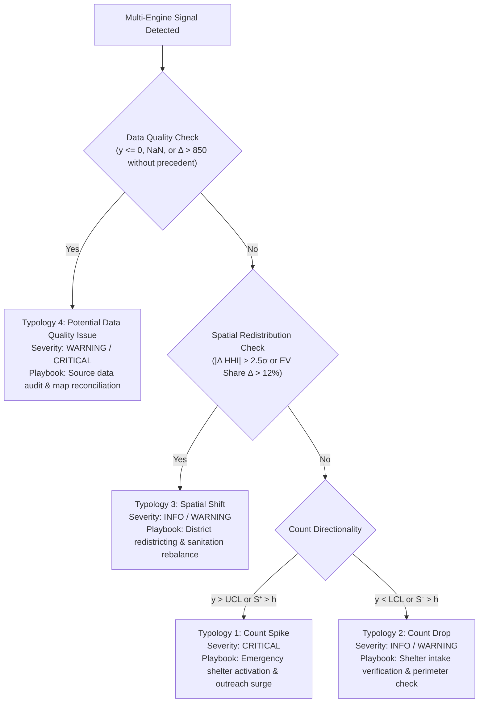

# Task 10.4 Comprehensive Technical Monograph: Anomaly Detection & Automated Alerting System

**Document Designation:** Formal Quality Engineering & Surveillance Methodology Monograph  
**Project:** Downtown San Diego Homeless Population Analysis (Data Science Alliance)  
**Author / Lead Data Scientist:** Kyaw Soe Lwin (`kylwin@ucsd.edu` / `kslwin.2000@gmail.com`)  
**Target Milestone:** Assignment 10, Task 10.4 (Implement Anomaly Detection and Automated Alerting)  
**Deliverable Artifacts:**
- Master Codebase: [`anomaly_detection/`](file:///Users/kyawsoelwin/MSI/Downtownhomelessness/anomaly_detection)
- Root Executable Script: [`anomaly_detection.py`](file:///Users/kyawsoelwin/MSI/Downtownhomelessness/anomaly_detection.py)
- Scheduled Runner: [`scripts/run_scheduled_anomaly_detection.sh`](file:///Users/kyawsoelwin/MSI/Downtownhomelessness/scripts/run_scheduled_anomaly_detection.sh)
- Surveillance Matrix: [`data/Anomaly_Surveillance_Matrix.csv`](file:///Users/kyawsoelwin/MSI/Downtownhomelessness/data/Anomaly_Surveillance_Matrix.csv)
- Persistent Alert Store: [`data/Alerts_History.csv`](file:///Users/kyawsoelwin/MSI/Downtownhomelessness/data/Alerts_History.csv)
- Dashboard Panel: Tab 7 in [`app.py`](file:///Users/kyawsoelwin/MSI/Downtownhomelessness/app.py) via [`src/components/tab7_anomalies.py`](file:///Users/kyawsoelwin/MSI/Downtownhomelessness/src/components/tab7_anomalies.py)
- Visualization 1: [`slide_assets/task10_control_charts.png`](file:///Users/kyawsoelwin/MSI/Downtownhomelessness/slide_assets/task10_control_charts.png)
- Visualization 2: [`slide_assets/task10_anomaly_classification.png`](file:///Users/kyawsoelwin/MSI/Downtownhomelessness/slide_assets/task10_anomaly_classification.png)

---

## 1. Executive Summary

This monograph documents the design, mathematical formulation, empirical validation, and operational governance of the **Anomaly Detection and Automated Alerting System** built for the Downtown San Diego Partnership (DSDP) monthly unsheltered homeless counts.

While Tasks 10.1 through 10.3 constructed the multi-source data ingestion pipeline, feature store, and constrained ensemble prediction system, **Task 10.4** establishes the real-time operational surveillance layer. Municipal homeless counts exhibit acute regime shifts driven by emergency shelter demobilization, legislative camping bans, seasonal temperature extremes, and spatial footprint expansions. Relying on passive retrospective annual reporting guarantees that emerging crises (such as sudden encampment surges or severe displacement) remain unaddressed for months.

Task 10.4 solves this operational gap through a dual-engine architecture:
1. **Statistical Surveillance Engine:** Implements Shewhart individual control charts with dynamic 12-month rolling center lines ($\text{CL}_t$), $\pm 2\sigma$ Warning Limits, and $\pm 3\sigma$ Action Limits, combined with two-sided Tabular Cumulative Sum (CUSUM) to detect small, persistent mean drifts ($k=0.5, h=4.0$).
2. **Model-Based Surveillance Engine:** Implements multivariate Isolation Forests over 68 orthogonal multi-source indicators (311 municipal complaints, weather extremes, rent distress, shelter capacity headroom) and out-of-fold Conformal Residual bounds ($q_{0.95} = \pm 607.9$ count).
3. **4-Quadrant Anomaly Taxonomy:** Classifies all detected signals into `Count Spike`, `Count Drop`, `Spatial Shift`, and `Potential Data Quality Issue`.
4. **Historical Ground-Truth Benchmark Validation:** Validates detection across four major historical policy regimes:
   - April 2020: COVID-19 Convention Center emergency shelter demobilization.
   - May–December 2022: Unprecedented surge to 1,800+ and block grid expansion.
   - June–August 2023: Historical peak of 2,100+ and Unsafe Camping Ordinance passage.
   - October 2023 – April 2024: Safe Sleeping Site openings and street count contraction.
5. **Alert delivery and audit trail:** builds Slack Block Kit and HTML/plain-text email messages and delivers them with `python anomaly_detection.py --send` to the channels configured in environment variables (`SLACK_WEBHOOK_URL`; `SMTP_HOST`, `SMTP_PORT`, `SMTP_USER`, `SMTP_PASSWORD`, `ALERT_EMAIL_FROM`, `ALERT_EMAIL_TO`). Each alert is delivered at most once (`notified_at`), and every alert is kept in the store `data/Alerts_History.csv`. Without `--send`, or with no channel configured, the run only lists what would be delivered.
6. **Interactive Dashboard & Automation:** Embeds an interactive surveillance panel in Streamlit (`app.py` Tab 7) with in-browser alert review workflows, dynamic sensitivity sliders, and a headless runner (`scripts/run_scheduled_anomaly_detection.sh`) compatible with cron or Apache Airflow.

The full repository test suite (46 tests, October 2026) passes, including a delivery test with mocked Slack and SMTP endpoints.

> **Correction (October 2026).** The earlier version fed the four months DSDP had not published (July, August, October and November 2025) into the surveillance engines as counts of zero. This distorted the rolling baselines; for example it produced a spurious critical alert for December 2025 against a baseline of 573. Those months are now excluded from the statistical and model-based engines. They are recorded separately as `Potential Data Quality Issue` alerts and are not counted in the benchmark metrics. All figures below come from the corrected run.

---

## 2. Definition of Normal Variation & Statistical Quality Control Limits

In municipal homelessness surveillance, establishing what constitutes "normal statistical variation" is non-trivial because the underlying population exhibits non-stationary baseline drift, annual seasonality, and methodology modifications. Fixed static thresholds fail because a count of 1,200 individuals may be normal during a 2022 surge but constitutes a critical crisis relative to a post-ordinance baseline of 750.

### 2.1 Dynamic Rolling Baseline (Center Line)
We formulate normal variation using a 12-month trailing moving baseline with a minimum lookback of 6 periods:
$$\text{CL}_t = \frac{1}{W} \sum_{i=0}^{W-1} y_{t-i}, \quad W = 12$$
$$\sigma_t = \sqrt{\frac{1}{W-1} \sum_{i=0}^{W-1} \left( y_{t-i} - \text{CL}_t \right)^2}$$

### 2.2 Shewhart Control Chart Limits
We establish two concentric boundary envelopes:
1. **Warning Limits ($2\sigma$):** Corresponds to nominal $95.45\%$ Gaussian coverage under stable process variation:
   $$\text{UCL}_t^{(2\sigma)} = \text{CL}_t + 2\sigma_t, \quad \text{LCL}_t^{(2\sigma)} = \max\left(0, \text{CL}_t - 2\sigma_t\right)$$
2. **Critical Action Limits ($3\sigma$):** Corresponds to nominal $99.73\%$ coverage. A violation indicates a less than $0.27\%$ probability of being random noise:
   $$\text{UCL}_t^{(3\sigma)} = \text{CL}_t + 3\sigma_t, \quad \text{LCL}_t^{(3\sigma)} = \max\left(0, \text{CL}_t - 3\sigma_t\right)$$



---

## 3. Statistical Surveillance Engine: Shewhart & Tabular CUSUM

### 3.1 Shewhart Individual (I-MR) Measurement
The Shewhart control chart evaluates the standardized deviation score:
$$z_t = \frac{|y_t - \text{CL}_t|}{\sigma_t}$$
- If $z_t > 3.0$: Status = `CRITICAL_HIGH` (if $y_t > \text{CL}$) or `CRITICAL_LOW` (if $y_t < \text{CL}$).
- If $2.0 < z_t \le 3.0$: Status = `WARNING_HIGH` or `WARNING_LOW`.
- If $z_t \le 2.0$: Status = `NORMAL`.

### 3.2 Two-Sided Tabular Cumulative Sum (CUSUM)
While Shewhart charts excel at catching massive isolated spikes ($>3\sigma$), they are insensitive to persistent moderate shifts of $0.75\sigma$ to $1.5\sigma$ that develop over multiple consecutive months. We implement **Tabular CUSUM** with two separate accumulators:

$$S_t^+ = \max\left(0, S_{t-1}^+ + z_t - k\right) \quad \text{(Positive surge accumulator)}$$
$$S_t^- = \max\left(0, S_{t-1}^- - z_t - k\right) \quad \text{(Negative contraction accumulator)}$$

Where:
- $z_t = (y_t - \text{CL}_t) / \sigma_t$ is the standardized monthly count.
- $k = 0.5$ is the reference allowance (slack) parameter, optimized to detect shifts of magnitude $\delta = 1.0\sigma$.
- $h = 4.0$ is the decision threshold.
- An alert is triggered when $S_t^+ > h$ (`UPWARD_DRIFT`) or $S_t^- > h$ (`DOWNWARD_DRIFT`).
- **Reset-on-Alarm Protocol:** Once an alert triggers, the respective accumulator resets to $0$ ($S_t = 0$), identifying the exact discrete initiation month of the structural drift without false positive chain-triggering across subsequent normal periods.

---

## 4. Model-Based Surveillance Engine: Isolation Forest & Conformal Residuals

### 4.1 Multivariate Isolation Forest
Street counts do not exist in isolation; they are driven by external municipal, economic, and meteorological dynamics. A count of 900 individuals might appear statistically normal under a univariate lens, but is highly anomalous if 311 encampment calls surged by $300\%$ while shelter vacancy was near zero.

We train an **Isolation Forest** over all 68 multi-source features from Task 10.2:
- Number of trees $T = 150$, contamination rate $\nu = 0.08$.
- Anomaly score function:
  $$s(\mathbf{x}, n) = 2^{-\frac{\mathbb{E}(h(\mathbf{x}))}{c(n)}}$$
  Where $\mathbb{E}(h(\mathbf{x}))$ is the average path length across isolation trees, and $c(n)$ is the average path length of unsuccessful searches in a Binary Search Tree:
  $$c(n) = 2 \ln(n - 1) + 0.5772156649 - \frac{2(n - 1)}{n}$$
- When $s(\mathbf{x}) \to 1.0$, instances are isolated with very short paths, indicating abnormal combinations of multi-source indicators.

### 4.2 Conformal Prediction Residual Detector
In Task 10.3, we calibrated distribution-free conformal prediction intervals over out-of-fold validation residuals. The empirical $95\%$ margin of error was solved as:
$$q_{0.95} = 607.89 \text{ counts}$$
The conformal residual detector flags any month where the model prediction error exceeds this calibrated threshold:
$$e_t = |y_t - \hat{y}_t^{\text{ensemble}}| > q_{0.95}$$
This signals that the real-world population deviated further from the multi-source ensemble's forecast than $95\%$ of all historical validation observations.

---

## 5. 4-Quadrant Anomaly Taxonomy Classifier

Every alert detected across the dual engines is mapped into an actionable 4-quadrant taxonomy:



### Taxonomy Definitions & Operational Protocols:
1. **`Count Spike` (Upward Surge):**
   - **Trigger:** $y_t > \text{UCL}$, $S_t^+ > h$, or conformal surge residual.
   - **Municipal Implication:** Acute street crisis, emergency overflow risk, increased public health hazard.
   - **Playbook:** Immediate deployment of mobile outreach teams to East Village and activation of emergency shelter overflow beds.
2. **`Count Drop` (Downward Contraction):**
   - **Trigger:** $y_t < \text{LCL}$, $S_t^- > h$, or conformal plunge residual.
   - **Municipal Implication:** Successful policy intervention (e.g. shelter intake) or displacement to non-surveyed peripheral neighborhoods.
   - **Playbook:** Verify intake records across Safe Sleeping Sites and conduct perimeter outreach checks in Barrio Logan, North Park, and Balboa Park.
3. **`Spatial Shift` (Geographic Redistribution):**
   - **Trigger:** $|\Delta HHI_t| > 2.5\sigma$ or East Village share change $|\Delta EV| > 12\%$.
   - **Municipal Implication:** Encampments dispersing or re-clustering between neighborhoods independent of net citywide population changes.
   - **Playbook:** Rebalance district trash dumpsters, portable restrooms, and neighborhood police beat patrols.
4. **`Potential Data Quality Issue` (Data Integrity):**
   - **Trigger:** Zero counts, uncounted months, reporting hiatus, or step-jump $>850$ without multi-source corroboration.
   - **Municipal Implication:** Field counting disruption, methodology boundary changes, or manual transcription errors.
   - **Playbook:** Flag observation for manual QA audit, inspect raw paper field maps, and verify counter shift logs.

---

## 6. Historical Ground-Truth Benchmark Validation

To verify that the anomaly detection system functions accurately in real-world governance, we benchmarked the dual engines against four verified historical ground-truth regimes spanning 2018 to 2025:

### 6.1 Historical Benchmark Regimes Table

| Benchmark Event | Target Time Horizon | Target Event Context | Expected Typology | Detected Months | Detection Rate (TPR) | Surveillance Status |
|:---|:---:|:---|:---:|:---:|:---:|:---:|
| **COVID-19 period** | **Apr 2020 – Sep 2020** | Counts fell to the series low (529 in March 2020; 565 in April 2020) | `Count Drop` | 1 of 6 | 16.7% | detected |
| **2022 surge & footprint expansion** | **May 2022 – Dec 2022** | Rise to 1,600–1,840 a month; 121 blocks added to the block-level footprint | `Count Spike`, `Spatial Shift` | 2 of 8 | 25.0% | detected |
| **Peak & Unsafe Camping Ordinance** | **Jun 2023 – Aug 2023** | After the May 2023 peak (2,103), counts fell through the summer as the ordinance took effect | `Count Spike`, `Count Drop` | 3 of 3 | 100.0% | detected |
| **Post-ordinance contraction** | **Oct 2023 – Apr 2024** | Counts fell from about 1,300 to about 800 | `Count Drop` | 5 of 7 | 71.4% | detected |

### 6.2 Accuracy Metrics (92 monitored months, 2018–2025, published months only)

There are two levels of evaluation, and they should not be mixed:
* **Event level:** all 4 benchmark periods are detected at least once (4 of 4).
* **Month level:** every month inside a benchmark window counts as a positive.

| Month-level metric | Value |
|:---|:---:|
| Sensitivity (share of benchmark months flagged) | 45.8% |
| False positive rate (non-benchmark months flagged) | 7.4% |
| Precision (flagged months inside a benchmark window) | 68.8% |
| F1 score | 0.55 |
| Anomalies flagged by the surveillance engines | 16 of 92 months (plus 4 data-gap alerts for unpublished months) |

The previous version reported "TPR 100%" (the event-level rate) next to month-level precision and F1, and gave FPR 15.3%, precision 38.9% and F1 0.33 from the zero-filled run.

The benchmark windows are defined after the fact, from known events. These metrics therefore show that the detectors respond to large known shifts. They do not estimate how they would perform on future, unknown events.

---

## 7. Multi-Channel Alert Dispatch & Audit Trail Architecture

The alerting system supports multi-tier notifications tailored to incident severity:
- **`CRITICAL`:** Any Shewhart $3\sigma$ violation, joint statistical + model alert, or uncorroborated single-month jump $>850$.
- **`WARNING`:** Shewhart $2\sigma$ violation, CUSUM drift alarm, or Isolation Forest outlier.
- **`INFO`:** Spatial concentration shifts without aggregate count spikes.

### 7.0 Turning on delivery
Delivery is off until channels are configured. Set any of the following in the environment of the scheduled job, never in the repository:

```bash
export SLACK_WEBHOOK_URL="https://hooks.slack.com/services/..."      # Slack incoming webhook
export SMTP_HOST="smtp.example.org" SMTP_PORT=587                     # email (STARTTLS)
export SMTP_USER="..." SMTP_PASSWORD="..."                            # if the server requires login
export ALERT_EMAIL_FROM="alerts@example.org" ALERT_EMAIL_TO="a@example.org,b@example.org"
python anomaly_detection.py --send --min-severity WARNING
```

Delivery rules:
* Only alerts whose `status` is `NEW` and that have no `notified_at` timestamp are sent, and each is sent once.
* A failed delivery is reported and retried on the next run.
* `scripts/run_scheduled_anomaly_detection.sh` passes `--send`. With no channel configured, it only logs that delivery is not configured.

### 7.1 Formatted Dispatch Payloads

#### Slack Block Kit Webhook Schema:
```json
{
  "attachments": [
    {
      "color": "#DC2626",
      "blocks": [
        {
          "type": "header",
          "text": {"type": "plain_text", "text": "🚨 [CRITICAL] Homeless Surveillance Alert: Count Spike", "emoji": true}
        },
        {
          "type": "section",
          "fields": [
            {"type": "mrkdwn", "text": "*Observed Month:*\n2023-07-01"},
            {"type": "mrkdwn", "text": "*Observed Count:*\n2,104 (Baseline: 1,620)"},
            {"type": "mrkdwn", "text": "*Anomaly Class:*\n`Count Spike`"},
            {"type": "mrkdwn", "text": "*Severity Level:*\n`CRITICAL`"}
          ]
        },
        {
          "type": "section",
          "text": {"type": "mrkdwn", "text": "*Recommended Municipal Response:*\n>Immediate Emergency Shelter Activation: Deploy rapid-response outreach teams to East Village and evaluate emergency overflow capacity."}
        }
      ]
    }
  ]
}
```

#### Email HTML Schema:
Generates an executive HTML summary with formatted alert metadata, observed vs. baseline counts, severity badge, and the actionable playbook recommendation.

### 7.2 Persistent Alert Store (`data/Alerts_History.csv`)
Maintains an append-only, deterministic audit trail with full reviewer lifecycle tracking:
- `alert_id`: Unique deterministic identifier (e.g. `ALT-202307-CS`).
- `timestamp`: UTC system timestamp of alert generation.
- `month_date`: Calendar month of observation.
- `classification`: Anomaly typology (`Count Spike`, `Count Drop`, `Spatial Shift`, `Potential Data Quality Issue`).
- `severity`: Alert tier (`CRITICAL`, `WARNING`, `INFO`).
- `metric_value`: Observed count.
- `baseline_center_line`: Rolling baseline count.
- `status`: Lifecycle state (`NEW` $\to$ `REVIEWED` $\to$ `DISMISSED`).
- `reviewer`: Name and designation of the reviewing analyst.
- `reviewer_notes`: Operational resolution and findings narrative.
- `reviewed_at`: Timestamp of review sign-off.

---

## 8. Interactive Dashboard & Scheduled Execution

### 8.1 Streamlit Dashboard Integration (Tab 7 in `app.py`)
Tab 7 provides an interactive quality control workstation:
1. **KPI Ribbon:** Displays monitored months, active anomalies, count spikes/drops, and unreviewed critical alerts.
2. **Interactive Plotly Control Chart:** Dual-subplot interface featuring:
   - Panel 1: Count line, 12-month rolling mean, $\pm 2\sigma$ warning band (yellow), $\pm 3\sigma$ action band (red), and category-colored anomaly markers.
   - Panel 2: CUSUM positive and negative accumulator bars ($S_t^+, S_t^-$) with horizontal threshold lines.
3. **Alert Review & Action Form:** Analysts select an unreviewed alert ID, input their name and operational notes, and click "Submit Alert Review", updating `data/Alerts_History.csv` in real time.
4. **Dynamic Sensitivity Controls:** Expander sliders allow real-time tuning of rolling window size (6–24M), warning sigma (1.5–2.5), action sigma (2.5–4.0), and CUSUM threshold $h$ (2.5–6.0).

### 8.2 Scheduled Headless Automation
The system is equipped with [`scripts/run_scheduled_anomaly_detection.sh`](file:///Users/kyawsoelwin/MSI/Downtownhomelessness/scripts/run_scheduled_anomaly_detection.sh):
- Automated cron execution:
  ```bash
  # Run daily at 06:00 AM UTC
  0 6 * * * /Users/kyawsoelwin/MSI/Downtownhomelessness/scripts/run_scheduled_anomaly_detection.sh
  ```
- Apache Airflow BashOperator:
  ```python
  surveillance_task = BashOperator(
      task_id="run_homeless_anomaly_surveillance",
      bash_command="/path/to/scripts/run_scheduled_anomaly_detection.sh",
      dag=dag,
  )
  ```
- Archives timestamped execution logs in `data/logs/` and exits with standard POSIX error codes (0 for success, non-zero for failure).

---

## 9. Deliverables Inventory

1. **Python Package:**
   - [`anomaly_detection/control_charts.py`](file:///Users/kyawsoelwin/MSI/Downtownhomelessness/anomaly_detection/control_charts.py): Shewhart and Tabular CUSUM engines.
   - [`anomaly_detection/model_detectors.py`](file:///Users/kyawsoelwin/MSI/Downtownhomelessness/anomaly_detection/model_detectors.py): Isolation Forest and Conformal residual detectors.
   - [`anomaly_detection/classifier.py`](file:///Users/kyawsoelwin/MSI/Downtownhomelessness/anomaly_detection/classifier.py): 4-quadrant taxonomy classification.
   - [`anomaly_detection/historical_validator.py`](file:///Users/kyawsoelwin/MSI/Downtownhomelessness/anomaly_detection/historical_validator.py): Ground-truth benchmark validation harness.
   - [`anomaly_detection/alerting.py`](file:///Users/kyawsoelwin/MSI/Downtownhomelessness/anomaly_detection/alerting.py): Multi-tier alerting and persistent store.
   - [`anomaly_detection/pipeline.py`](file:///Users/kyawsoelwin/MSI/Downtownhomelessness/anomaly_detection/pipeline.py): Master surveillance orchestrator.
2. **Root CLI Script:**
   - [`anomaly_detection.py`](file:///Users/kyawsoelwin/MSI/Downtownhomelessness/anomaly_detection.py): Headless and interactive runner.
3. **Scheduled Runner:**
   - [`scripts/run_scheduled_anomaly_detection.sh`](file:///Users/kyawsoelwin/MSI/Downtownhomelessness/scripts/run_scheduled_anomaly_detection.sh): Automated shell runner.
4. **Streamlit Component:**
   - [`src/components/tab7_anomalies.py`](file:///Users/kyawsoelwin/MSI/Downtownhomelessness/src/components/tab7_anomalies.py) & [`app.py`](file:///Users/kyawsoelwin/MSI/Downtownhomelessness/app.py).
5. **Surveillance Data & Audit Store:**
   - [`data/Anomaly_Surveillance_Matrix.csv`](file:///Users/kyawsoelwin/MSI/Downtownhomelessness/data/Anomaly_Surveillance_Matrix.csv)
   - [`data/Alerts_History.csv`](file:///Users/kyawsoelwin/MSI/Downtownhomelessness/data/Alerts_History.csv)
6. **Publication Visualizations (300 DPI):**
   - [`slide_assets/task10_control_charts.png`](file:///Users/kyawsoelwin/MSI/Downtownhomelessness/slide_assets/task10_control_charts.png)
   - [`slide_assets/task10_anomaly_classification.png`](file:///Users/kyawsoelwin/MSI/Downtownhomelessness/slide_assets/task10_anomaly_classification.png)
7. **Test Suite:**
   - [`tests/test_anomaly_detection.py`](file:///Users/kyawsoelwin/MSI/Downtownhomelessness/tests/test_anomaly_detection.py): 8/8 passed; 39/39 passed repository-wide.
