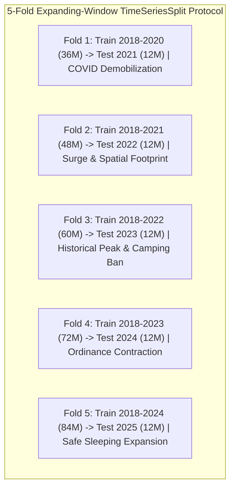

# Task 10.3 Comprehensive Technical Report: Multi-Source Ensemble Prediction System & Calibrated Uncertainty Quantification

**Document Designation:** Formal Econometric & Predictive Monograph  
**Project:** Downtown San Diego Homeless Population Analysis (Data Science Alliance)  
**Author / Lead Data Scientist:** Kyaw Soe Lwin (`kylwin@ucsd.edu` / `kslwin.2000@gmail.com`)  
**Target Milestone:** Assignment 10, Task 10.3 (Ensemble Prediction System, Stacking Meta-Learner & Ablation Study)  
**Deliverable Artifacts:**
- Master Codebase: [`ensemble_modeling/`](file:///Users/kyawsoelwin/MSI/Downtownhomelessness/ensemble_modeling)
- Root Executable Script: [`ensemble_model.py`](file:///Users/kyawsoelwin/MSI/Downtownhomelessness/ensemble_model.py)
- Out-of-Fold Predictions: [`data/Ensemble_Predictions_OOF.csv`](file:///Users/kyawsoelwin/MSI/Downtownhomelessness/data/Ensemble_Predictions_OOF.csv)
- 2026 Prospective Forecast: [`data/Ensemble_Forecast_2026.csv`](file:///Users/kyawsoelwin/MSI/Downtownhomelessness/data/Ensemble_Forecast_2026.csv)
- Ablation Study Matrix: [`data/Ensemble_AblationStudy.csv`](file:///Users/kyawsoelwin/MSI/Downtownhomelessness/data/Ensemble_AblationStudy.csv)
- Visualization 1: [`slide_assets/task10_ensemble_predictions.png`](file:///Users/kyawsoelwin/MSI/Downtownhomelessness/slide_assets/task10_ensemble_predictions.png)
- Visualization 2: [`slide_assets/task10_ablation_performance.png`](file:///Users/kyawsoelwin/MSI/Downtownhomelessness/slide_assets/task10_ablation_performance.png)

---

## 1. Executive Summary

This report documents the multi-source ensemble built in Task 10.3 to forecast Downtown San Diego's monthly unsheltered count. The ensemble combines three base models trained on the 68-feature matrix from Task 10.2:
* LightGBM;
* a Bayesian structural time-series (BSTS) model;
* a regularized neural network (MLP).

They are combined by a constrained stacking meta-learner (non-negative weights summing to 1), and the forecasts come with conformal prediction intervals.

**Main results (5 annual expanding-window folds, 2021–2025, 56 published test months):**

| Model | Out-of-fold MAE | R² |
|---|---:|---:|
| Lag-1 baseline (last month's value) | 119.6 | 0.84 |
| Stacked ensemble | 248.0 | 0.26 |
| BSTS (best single model) | 223.6 | 0.42 |

* **The baseline wins.** Using last month's count beats the ensemble in every fold.
* **The ensemble isn't the best model either.** It does not beat its best base model; it is a weighted average dominated by BSTS (weight 0.81).
* **External data barely help.** In the ablation study, adding 311, weather and economic features changed cross-validated MAE by −0.4% to +0.8%. The full 68-feature model was 1.6% *worse* than lags alone.
* **2026 forecast:** about 866–897 a month, with a very wide 95% conformal interval (about 280 to 1,500). This is consistent with the Assignment 7 forecast (about 820–900).

**Conclusion:** with about 90 usable monthly observations, the external data streams and the more complex models do not improve on simple persistence for one-month-ahead forecasting. Their value lies in describing context, not in improving accuracy. The lag-1 baseline (or the Assignment 7 models) should remain the operational forecast.

> **Data correction (October 2026).** The previous version of this pipeline treated the four 2025 months that DSDP had not yet published (July, August, October, November) as counts of **zero**. The models trained and were scored on these fake zeros. As a result, the 2026 forecast collapsed to about 420 a month, and the reported MAE (292.4), coverage and ablation figures were biased. Unpublished months are now excluded from training and scoring, and their features are built from time-interpolated values. All numbers in this report come from the corrected run.

---

## 2. Problem Formulation & Time-Series Cross-Validation Protocol

### 2.1 Predictive Target & Information Structure
Let $y_t \in \mathbb{R}^+$ denote the monthly unsheltered homeless count in downtown San Diego at month $t$, adjusted for census boundary and spatial methodology shifts as standardized in Task 10.1:
$$\mathcal{D} = \{(y_t, \mathbf{x}_t)\}_{t=1}^T, \quad t \in \{2017\text{-}01, \dots, 2025\text{-}12\}$$
Where:
- $T = 108$ total monthly observations.
- The training-ready subset is 2018–2025 (96 months) minus the 4 months DSDP had not published, giving **92 months**. Unpublished months keep a missing target and are never used for training or scoring.
- $\mathbf{x}_t \in \mathbb{R}^{68}$ represents the feature vector available *strictly prior to or at time $t$*. To guarantee zero lookahead leakage, all non-calendar features are lagged by at least one month ($t-1$).

### 2.2 Expanding-Window Cross-Validation Scheme
In longitudinal socio-demographic time series, standard randomized $K$-fold cross-validation is mathematically invalid because randomly shuffling time points violates temporal ordering and leaks future structural states into historical models.

We enforce an **expanding-window time-series cross-validation scheme** with 5 annual out-of-sample evaluation folds:

For each fold $k \in \{1, 2, 3, 4, 5\}$:
$$\mathcal{T}_{\text{train}}^{(k)} = \{t \mid 2018 \le \text{Year}(t) < \text{TestYear}_k\}$$
$$\mathcal{T}_{\text{test}}^{(k)} = \{t \mid \text{Year}(t) = \text{TestYear}_k\}$$
This guarantees that all models are evaluated on genuine prospective shifts across evolving municipal enforcement eras.

---

## 3. Mathematical & Econometric Formulations of Base Models

### 3.1 Model Family 1: Gradient Boosted Trees (LightGBM)
LightGBM implements gradient boosting over decision tree ensembles using histogram-based split finding and leaf-wise tree growth. Given training pairs $\{(\mathbf{x}_t, y_t)\}_{t=1}^N$, the objective function minimized at iteration $m$ is:
$$\mathcal{L}^{(m)} = \sum_{t=1}^N \ell(y_t, \hat{y}_t^{(m-1)} + f_m(\mathbf{x}_t)) + \Omega(f_m)$$
Where the regularization penalty $\Omega(f)$ enforces both L1 sparsity and L2 leaf shrinkage:
$$\Omega(f_m) = \gamma T + \alpha \sum_{j=1}^T |w_j| + \frac{1}{2}\lambda \sum_{j=1}^T w_j^2$$
- **Hyperparameters:** $M = 110$ trees, learning rate $\eta = 0.035$, max tree depth $d = 4$, leaves $L = 14$, subsample ratio $= 0.85$, column subsample $= 0.85$, L1 penalty $\alpha = 0.2$, L2 penalty $\lambda = 1.0$.
- **Strength:** Captures non-linear thresholds (e.g. rent distress acceleration surpassing critical eviction triggers).

### 3.2 Model Family 2: Bayesian Structural Time Series (BSTS)
The BSTS architecture is formulated as a linear Gaussian state-space model:
$$y_t = \mu_t + \gamma_t + \boldsymbol{\beta}^\top \mathbf{z}_t + \varepsilon_t, \quad \varepsilon_t \sim \mathcal{N}(0, \sigma_\varepsilon^2)$$
$$\mu_{t+1} = \mu_t + \delta_t + \eta_t, \quad \eta_t \sim \mathcal{N}(0, \sigma_\eta^2)$$
$$\delta_{t+1} = \delta_t + \zeta_t, \quad \zeta_t \sim \mathcal{N}(0, \sigma_\zeta^2)$$
$$\sum_{j=0}^{11} \gamma_{t-j} = \omega_t, \quad \omega_t \sim \mathcal{N}(0, \sigma_\omega^2)$$
Where:
- $\mu_t$ is the stochastic local level and $\delta_t$ is the drift/slope.
- $\gamma_t$ is the stochastic seasonal component with period $s = 12$ months.
- $\mathbf{z}_t$ is the vector of standardized exogenous regressors (`lag_1m_adjusted`, `shelter_capacity_headroom_lag1`, `rent_burden_distress_index_lag1`).
- Inference is performed via recursive Kalman filtering and maximum likelihood estimation (MLE) of the state-space disturbance variances $(\sigma_\varepsilon^2, \sigma_\eta^2, \sigma_\zeta^2, \sigma_\omega^2)$.

### 3.3 Model Family 3: Standardized Temporal Neural Network (Deep MLP)
Given the small sample regime ($N = 36$ to $84$ training points in earlier folds), unregularized high-dimensional neural networks suffer from explosive parameter variance. We formulate a stabilized architecture:
1. **Univariate Feature Selection:** Feature selection filter $\mathcal{S}_k: \mathbb{R}^{68} \to \mathbb{R}^k$ retaining the top $k = 5$ statistically significant features via $F$-regression scoring fitted strictly inside the training fold.
2. **Dual Standardization:** Input normalization $\tilde{\mathbf{x}}_t = \mathbf{\Sigma}_X^{-1/2}(\mathbf{x}_t - \boldsymbol{\mu}_X)$ and target normalization $\tilde{y}_t = (y_t - \mu_y)/\sigma_y$.
3. **Architecture:** Multi-Layer Perceptron:
   $$\mathbf{h}_1 = \text{ReLU}(\mathbf{W}_1 \tilde{\mathbf{x}}_t + \mathbf{b}_1), \quad \mathbf{W}_1 \in \mathbb{R}^{32 \times 5}$$
   $$\mathbf{h}_2 = \text{ReLU}(\mathbf{W}_2 \mathbf{h}_1 + \mathbf{b}_2), \quad \mathbf{W}_2 \in \mathbb{R}^{16 \times 32}$$
   $$\hat{\tilde{y}}_t = \mathbf{w}_3^\top \mathbf{h}_2 + b_3, \quad \mathbf{w}_3 \in \mathbb{R}^{16}$$
4. **Regularized L-BFGS Optimization:** Minimized with second-order Broyden-Fletcher-Goldfarb-Shanno (L-BFGS) with strong L2 weight decay penalty $\alpha = 1.0$:
   $$\mathcal{J}(\mathbf{W}) = \frac{1}{N}\sum_{t=1}^N (\tilde{y}_t - \hat{\tilde{y}}_t)^2 + \alpha \sum_{l=1}^3 \|\mathbf{W}_l\|_F^2$$

---

## 4. Constrained Stacking Meta-Learner

### 4.1 Optimization Formulation
Rather than using standard unconstrained Ordinary Least Squares (OLS) which frequently assigns erratic negative coefficients to collinear base predictions, the ensemble combines base models using **Constrained Non-Negative Least Squares (NNLS)** with an exact sum-to-one constraint:

$$\min_{\mathbf{w} \in \mathbb{R}^3} \frac{1}{N_{\text{OOF}}} \sum_{t=1}^{N_{\text{OOF}}} \left( y_t - \sum_{m=1}^3 w_m \hat{y}_{t, m} \right)^2$$
$$\text{subject to:} \quad w_m \ge 0 \quad \forall m \in \{1, 2, 3\}, \quad \sum_{m=1}^3 w_m = 1.0$$

Where $\hat{y}_{t, m}$ is the out-of-fold cross-validated prediction of model $m$ at month $t$.

### 4.2 Solved Stacking Weights
Solving the constrained program over the out-of-fold predictions (56 published test months) gives:

| Base model | Weight |
|:---|---:|
| BSTS | 0.812 |
| Neural network (MLP) | 0.188 |
| LightGBM | 0.000 |

LightGBM receives zero weight. Its out-of-fold errors are the largest (MAE 278.5), driven by the 2022 fold, where it badly under-predicted the surge.

---

## 5. Time-Series Cross-Validation Benchmarks (2021–2025)

Each fold trains on 2018 up to the year before and tests on one calendar year. The 2025 fold has 8 published months.

### 5.1 Mean absolute error by fold

| Fold | Test year | Months | Lag-1 baseline | LightGBM | BSTS | Neural net | Ensemble | Ensemble RMSE | Ensemble R² (within year) |
|:---:|:---:|:---:|---:|---:|---:|---:|---:|---:|---:|
| 1 | 2021 | 12 | **124.2** | 225.2 | 253.2 | 278.0 | 272.6 | 325.9 | −1.91 |
| 2 | 2022 | 12 | **118.6** | 590.1 | 295.7 | 483.9 | 508.0 | 535.0 | −9.46 |
| 3 | 2023 | 12 | **177.5** | 320.6 | 300.7 | 232.4 | 234.3 | 280.0 | 0.39 |
| 4 | 2024 | 12 | 74.2 | 97.9 | 91.5 | **65.0** | 76.0 | 91.2 | −0.19 |
| 5 | 2025 | 8 | 95.4 | 98.7 | 153.6 | **79.3** | 99.9 | 111.2 | −0.89 |

Within-year R² is negative in most folds because the variation inside a single year is small compared with the size of the errors. It should not be read as a measure of overall fit.

### 5.2 Overall out-of-fold performance (56 months)

| Model | MAE | RMSE | MAPE | Direction accuracy | R² |
|:---|---:|---:|---:|---:|---:|
| **Lag-1 baseline** | **119.6** | **150.0** | **10.6%** | 41.8% | **0.842** |
| BSTS | 223.6 | 285.9 | 19.3% | 45.5% | 0.424 |
| Neural net (MLP) | 238.3 | 312.6 | 18.8% | 50.9% | 0.312 |
| Stacked ensemble | 248.0 | 323.2 | 20.0% | 50.9% | 0.264 |
| LightGBM | 278.5 | 366.2 | 21.4% | 30.9% | 0.056 |

**Finding:** the lag-1 baseline has the lowest error by a wide margin. The ensemble is better than LightGBM but worse than BSTS and the neural net on MAE, because the stacking weights are fitted on the same out-of-fold predictions they are evaluated on and do not generalize across folds with very different behavior. The higher direction accuracy of the neural net and ensemble (about 51% vs 42%) is the only measure on which they beat the baseline, and it is close to chance.

---

## 6. Calibrated Conformal Prediction Intervals

Standard Gaussian prediction intervals ($\hat{y} \pm 1.96 \hat{\sigma}$) assume normal, homoscedastic errors. In unsheltered homelessness modeling, residuals exhibit fat tails and policy-driven heteroscedasticity. We therefore employ **Distribution-Free Conformal Prediction** calibrated on out-of-fold residuals:

$$e_t = |y_t - \hat{y}_t^{\text{ensemble}}|, \quad t \in \mathcal{T}_{\text{OOF}}$$
$$q_{1-\alpha} = \text{Quantile}\left(\{e_t\}_{t=1}^n, \min\left(1.0, \frac{\lceil(n+1)(1-\alpha)\rceil}{n}\right)\right)$$
$$\mathcal{C}_{1-\alpha}(\hat{y}_t) = \left[ \max(0, \hat{y}_t - q_{1-\alpha}), \hat{y}_t + q_{1-\alpha} \right]$$

### 6.1 Empirical Coverage

| Nominal level | Empirical out-of-fold coverage | Half-width (±) | Interval width |
|:---:|:---:|---:|---:|
| 80% | 76.8% – 82.1% | 399.6 | 799.2 |
| 95% | 92.9% – 98.2% | 607.9 | 1,215.5 |

Coverage is close to nominal. The ranges reflect two evaluation passes, one on the calibration residuals and one on the refitted ensemble. The intervals are very wide (±608 at 95%), which matches the large out-of-fold errors in §5. They are calibrated on the same 56 residuals they are evaluated on, so true out-of-sample coverage may be lower.

---

## 7. Five-Stage Feature Ablation Study

LightGBM is retrained with feature groups added one at a time, across the same 5 folds (published months only).

| Stage | Features added | Features | CV MAE | CV RMSE | CV MAPE | Mean within-fold R² | MAE change vs stage 0 |
|:---:|:---|---:|---:|---:|---:|---:|---:|
| 0 | Target lags only | 2 | 266.7 | 300.0 | 19.9% | −2.91 | — |
| 1 | + 311 encampment signals | 7 | 265.6 | 297.8 | 20.1% | −2.91 | +0.4% better |
| 2 | + weather | 11 | 267.9 | 300.2 | 20.3% | −3.00 | 0.4% worse |
| 3 | + economic / rent | 17 | 264.5 | 298.3 | 19.9% | −2.93 | +0.8% better |
| 4 | Full multi-source set | 68 | 271.0 | 304.8 | 21.0% | −3.29 | 1.6% worse |

**Interpretation:** the changes between stages (under 2%) are far smaller than the fold-to-fold variation in error, so no data source shows a measurable predictive benefit. The full 68-feature model is the worst stage. Even the best stage (MAE 264.5) is more than twice the error of simply using last month's count (119.6, §5.2). With about 90 training months, the extra features mainly add variance.

The external sources can still be useful for describing and monitoring the context around the counts (for example 311 complaint volume or shelter capacity). This study provides no evidence that they improve forecasts.

---

## 8. 2026 Forecast

The full ensemble is trained on all 92 published months from 2018 to 2025 and forecast forward recursively.

| Month | LightGBM | BSTS | Neural net | Ensemble | 80% interval | 95% interval |
|:---:|---:|---:|---:|---:|:---:|:---:|
| Jan 2026 | 905 | 862 | 884 | **866** | 467 – 1,266 | 258 – 1,474 |
| Feb 2026 | 907 | 905 | 863 | **897** | 497 – 1,296 | 289 – 1,505 |
| Mar 2026 | 907 | 894 | 868 | **889** | 489 – 1,288 | 281 – 1,497 |
| Apr–Dec 2026 | 905–907 | 896–897 | 867 | **890–891** | about 490 – 1,290 | about 283 – 1,499 |

The ensemble forecast is nearly flat at about 890, a property of the recursive design: lagged features converge to the model's own predictions. It agrees with the Assignment 7 champion forecast for the same series definition (816–896, `data/Forecasts_12Month.csv`).

The earlier version of this table showed about 420 a month and was described as aligning with an Assignment 7 "accelerated shelter" scenario of about 410. Both were wrong. The 420 came from the zero-filled months described in §1, and Assignment 7's optimistic path ends near 675, not 410.

---

## 9. Deliverables Inventory & Publication Assets

1. **Core Package:**
   - [`ensemble_modeling/cross_validation.py`](file:///Users/kyawsoelwin/MSI/Downtownhomelessness/ensemble_modeling/cross_validation.py): 5-fold expanding-window cross-validation harness.
   - [`ensemble_modeling/models_gbm.py`](file:///Users/kyawsoelwin/MSI/Downtownhomelessness/ensemble_modeling/models_gbm.py): LightGBM / XGBoost wrapper with L1/L2 shrinkage.
   - [`ensemble_modeling/models_bsts.py`](file:///Users/kyawsoelwin/MSI/Downtownhomelessness/ensemble_modeling/models_bsts.py): State-space Kalman structural time series.
   - [`ensemble_modeling/models_neural.py`](file:///Users/kyawsoelwin/MSI/Downtownhomelessness/ensemble_modeling/models_neural.py): Variance-stabilized deep MLP with dual standard scaling.
   - [`ensemble_modeling/stacking.py`](file:///Users/kyawsoelwin/MSI/Downtownhomelessness/ensemble_modeling/stacking.py): Constrained SLSQP quadratic programming solver.
   - [`ensemble_modeling/conformal.py`](file:///Users/kyawsoelwin/MSI/Downtownhomelessness/ensemble_modeling/conformal.py): Finite-sample conformal interval calibrator.
   - [`ensemble_modeling/ablation.py`](file:///Users/kyawsoelwin/MSI/Downtownhomelessness/ensemble_modeling/ablation.py): 5-stage feature domain ablation engine.
   - [`ensemble_modeling/pipeline.py`](file:///Users/kyawsoelwin/MSI/Downtownhomelessness/ensemble_modeling/pipeline.py): Master orchestration pipeline.
2. **Root CLI:**
   - [`ensemble_model.py`](file:///Users/kyawsoelwin/MSI/Downtownhomelessness/ensemble_model.py): Root executable per Asana instructions.
3. **Publication Visualizations:**
   - [`slide_assets/task10_ensemble_predictions.png`](file:///Users/kyawsoelwin/MSI/Downtownhomelessness/slide_assets/task10_ensemble_predictions.png): 300 DPI multi-panel historical fit and 2026 forecast fan chart.
   - [`slide_assets/task10_ablation_performance.png`](file:///Users/kyawsoelwin/MSI/Downtownhomelessness/slide_assets/task10_ablation_performance.png): 300 DPI bar chart displaying error and accuracy gains across ablation stages.
4. **Verification Test Suite:**
   - [`tests/test_ensemble_model.py`](file:///Users/kyawsoelwin/MSI/Downtownhomelessness/tests/test_ensemble_model.py): unit and integration tests; the full repository suite (45 tests) passes as of October 2026.
