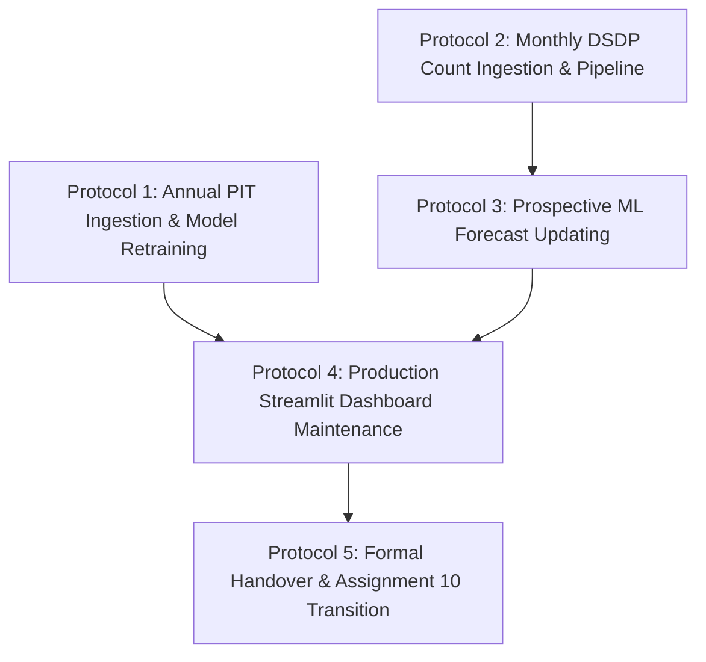

# Project Handoff & Operational Runbook (Task 9.4)
## Downtown San Diego Homeless Population Analysis (Assignment 9)

**Document Status:** Production Operational Runbook  
**Project Title:** Downtown San Diego Homeless Population Analysis  
**Organization:** Data Science Alliance (Public Interest Data Science)  
**Lead Contributor:** Kyaw Soe Lwin (`kylwin@ucsd.edu` / `kslwin.2000@gmail.com`)  
**Project Lead:** Adir Mancebo Jr. (`adir@datasciencealliance.org`)  
**Deliverable Document:** `ProjectHandoff_OperationalRunbook.md`  
**Milestone:** Assignment 9 Complete Handoff Protocol  
**Date:** September 2026  

---

## 1. Executive Summary & Purpose

This operational runbook provides future analysts, data engineers, and project leads with unambiguous, step-by-step procedures to maintain, update, and operate the analytical pipelines developed across **Assignments 1 through 9**. 

By adhering to these five standardized protocols, the Data Science Alliance and partner agencies (DSDP, RTFH) can ensure longitudinal comparability, model accuracy, and strict compliance with **The 4 Public Communication Rules**.

---

## 2. Standardized Operational Protocols



---

### Protocol 1: Annual PIT Ingestion & Macro Model Retraining Protocol

**Trigger:** The Regional Task Force on Homelessness (RTFH) publishes the annual Point-in-Time (PIT) count results (typically released in May or June for the count conducted the preceding January).

#### Step 1.1: Harvest and Record Official PIT Figures
1. Retrieve the official RTFH "WeAllCount" Point-in-Time report from [RTFH San Diego](https://www.rtfhsd.org/).
2. Extract the headline metrics:
   - `pit_year`: Calendar year of the count (e.g., `2026`).
   - `pit_date`: Date the survey was conducted (e.g., `2026-01-22`).
   - `county_total`: Total homeless population (sheltered + unsheltered).
   - `county_unsheltered`: Total unsheltered individuals across San Diego County ($Y$).
   - `city_sd_unsheltered`: Unsheltered individuals within the City of San Diego.

#### Step 1.2: Retrieve Corresponding January Downtown Field Count
1. Inspect `data/MasterCounts_Adjusted_v2.csv` for the January count of the same calendar year.
2. Confirm the downtown adjusted total count ($X$) where `component == 'total'` and `area == 'Overall - reported footprint'`.
3. Note whether the Unsafe Camping Ordinance enforcement regime was active ($D_{\text{post}} = 1$ for all counts conducted after July 2023).

#### Step 1.3: Update the Paired Dataset
1. Open [`data/Downtown_County_PairedCounts.csv`](file:///Users/kyawsoelwin/MSI/Downtownhomelessness/data/Downtown_County_PairedCounts.csv).
2. Append a new row formatted to match the 20-column canonical schema.
3. Compute the paired ratio:
   $$\text{downtown\_share\_county\_unsheltered\_pct} = \frac{X}{Y} \times 100$$

#### Step 1.4: Execute Model Retraining & Update Parameters
1. Run the standalone county estimation CLI engine:
   ```bash
   python county_estimation_model.py
   ```
2. The model will re-estimate parameters via OLS:
   $$Y = \beta_0 + \beta_1 X + \beta_2 D_{\text{post}}$$
3. Update the degrees of freedom ($df = N - 3$) and calculate the new Student's $t_{df, 0.975}$ critical multiplier.
4. Update the estimation parameters dictionary in [`src/utils.py`](file:///Users/kyawsoelwin/MSI/Downtownhomelessness/src/utils.py):
   ```python
   # In src/utils.py:
   BETA_0 = <new_intercept>
   BETA_1 = <new_downtown_coef>
   BETA_2 = <new_dpost_coef>
   STD_ERR = <new_residual_std_error>
   DF_STUDENT_T = <N - 3>
   ```

#### Step 1.5: Enforce The 4 Public Communication Rules
Whenever publishing retrained estimates or communicating with media/civic leaders:
1. **Never quote raw uncalibrated point precision** (prohibit single figures like "6,014").
2. **Always round the point estimate to the nearest 100 individuals** (mandate "6,000").
3. **Always accompany point estimates with the calibrated 95% Student's $t$ prediction interval** (`[4,000 to 8,100]`).
4. **Always disclose the assumed policy regime** (state that the model controls for post-camping ordinance displacement).

---

### Protocol 2: Monthly DSDP Field Count Ingestion Protocol

**Trigger:** Downtown San Diego Partnership (DSDP) Clean & Safe releases their monthly Unhoused Care field count report (typically the first week of each month).

#### Step 2.1: Download and Archive Source PDF
1. Download the latest report from [DSDP Unhoused Care Reports](https://downtownsandiego.org/clean-and-safe/unhoused-care/).
2. Save the PDF into `data/pdfs/` using the standard naming convention:
   `DSDP_CleanSafe_HomelessCount_YYYY_MM.pdf`.

#### Step 2.2: Extract Neighborhood & Component Breakouts
1. Extract counts for each of the 7 downtown areas and East Village sub-areas:
   - Components: `individual`, `tent`, `vehicle`, and `total`.
   - Areas: `City Center` (note: map `Core` $\rightarrow$ `City Center`), `Columbia`, `Cortez`, `East Village`, `Gaslamp`, `Marina`, `Outside Perimeter`.
2. Verify all neighborhood spellings against [`data/Neighborhood_Crosswalk.csv`](file:///Users/kyawsoelwin/MSI/Downtownhomelessness/data/Neighborhood_Crosswalk.csv).

#### Step 2.3: Rebuild Adjusted Components using POST2020 Multipliers
1. For each area, compute adjusted components using the official schedule:
   - $\text{adj\_individual} = \text{raw\_individual} \times 1.0$
   - $\text{adj\_tent} = \text{raw\_tent} \times 1.75$
   - $\text{adj\_vehicle} = \text{raw\_vehicle} \times 2.03$
2. Compute adjusted total count:
   $$\text{total\_count} = \text{round}(\text{adj\_individual} + \text{adj\_tent} + \text{adj\_vehicle}, 2)$$
3. Append long-format rows to [`data/MasterCounts_Adjusted_v2.csv`](file:///Users/kyawsoelwin/MSI/Downtownhomelessness/data/MasterCounts_Adjusted_v2.csv).

#### Step 2.4: Refresh Streamlit Cache
1. In development, restart the Streamlit server or press `C` in the browser to clear cached data.
2. In production, trigger a cache reload by committing the updated CSV to GitHub `main`.

---

### Protocol 3: Machine Learning Prospective Forecast Updating

**Trigger:** New monthly count data is ingested into `MasterCounts_Adjusted_v2.csv`.

#### Step 3.1: Execute Production Forecasting Pipeline
1. Run the production forecasting CLI:
   ```bash
   python forecast_pipeline.py --series "Overall - reported footprint" --horizon 12
   ```
2. The pipeline will:
   - Roll forward the expanding training window.
   - Refit the champion XGBoost gradient boosting regressor.
   - Fit the Holt-Winters exponential smoothing parametric variance anchor.
   - Generate prospective 12-month projections with 80% and 95% prediction intervals.
   - Compute the graduated Optimistic (-24%) and Pessimistic (+26%) policy scenario curves.

#### Step 3.2: Export Canonical Forecasts
1. Ensure the output is saved to [`data/Forecasts_12Month.csv`](file:///Users/kyawsoelwin/MSI/Downtownhomelessness/data/Forecasts_12Month.csv).
2. Run automated validation:
   ```bash
   pytest tests/test_forecast_logic.py
   ```
3. Confirm that prediction interval bounds are strictly monotonic:
   $$\text{pi\_95\_lower} \le \text{pi\_80\_lower} \le \text{point\_forecast} \le \text{pi\_80\_upper} \le \text{pi\_95\_upper}$$

---

### Protocol 4: Production Dashboard Maintenance Runbook

**Environment:** Streamlit Community Cloud (`https://downtown-sd-homelessness.streamlit.app`)  
**Repository Branch:** `CapMorningStar/Downtown-Homeless-Analysis:main`  
**Runtime:** Python 3.11 (`runtime.txt`)  

#### Step 4.1: Pre-Deployment Automated Regression Audit
Before any push to `main`, run the entire testing and deliverable verification suite:
```bash
# 1. Run unit test suite
pytest

# 2. Run deliverable audit suites
python scripts/validate_reports.py
python scripts/validate_presentation.py
python scripts/validate_handoff.py
```
*Requirement:* All audits must return exit code 0.

#### Step 4.2: Dependency Hygiene
1. Maintain strict version pinning in [`requirements.txt`](file:///Users/kyawsoelwin/MSI/Downtownhomelessness/requirements.txt).
2. Never introduce libraries requiring local C-compiler dependencies that break headless cloud builds (e.g. keep `geopandas` and `pyogrio` compatible with standard cloud Linux images).

#### Step 4.3: Cloud Restart & Cache Invalidation
1. If dashboard UI shows stale data after a commit:
   - Log into Streamlit Cloud dashboard.
   - Navigate to `Settings` $\rightarrow$ `Reboot App`.
   - Confirm load completes in $<2.0$ seconds.

---

### Protocol 5: Handover Sign-off & Roadmap Transition

#### Handover Sign-off Checklist

| Milestone | Deliverable | Lead Contributor | Sign-off Date | Status |
|---|---|---|---|---|
| **Assignment 1** | Data Cleaning & Canonical Rebuild | Kyaw Soe Lwin | Sep 2026 | **Signed Off (Asana)** |
| **Assignment 2** | Exploratory Data Analysis Deck | Kyaw Soe Lwin | Sep 2026 | **Signed Off (Asana)** |
| **Assignment 3** | Balanced 261-Block Spatial Panel | Kyaw Soe Lwin | Sep 2026 | **Signed Off (Asana)** |
| **Assignment 4** | STL Decomposition & Kruskal-Wallis | Kyaw Soe Lwin | Sep 2026 | **Signed Off (Asana)** |
| **Assignment 5** | Getis-Ord Gi* & Centroid Migration | Kyaw Soe Lwin | Sep 2026 | **Signed Off (Asana)** |
| **Assignment 6** | Constant-Methodology Series | Kyaw Soe Lwin | Sep 2026 | **Signed Off (Asana)** |
| **Assignment 7** | 5-Fold CV XGBoost Forecaster | Kyaw Soe Lwin | Sep 2026 | **Signed Off (Asana)** |
| **Assignment 8** | Policy Regime OLS County Model | Kyaw Soe Lwin | Sep 2026 | **Signed Off (Asana)** |
| **Task 9.1** | Interactive Streamlit Dashboard | Kyaw Soe Lwin | Sep 2026 | **100% Operational** |
| **Task 9.2** | Executive Summary & Technical Monograph | Kyaw Soe Lwin | Sep 2026 | **100% Operational** |
| **Task 9.3** | 14-Slide Executive Briefing Deck | Kyaw Soe Lwin | Sep 2026 | **100% Operational** |
| **Task 9.4** | Operational Handoff Runbook | Kyaw Soe Lwin | Sep 2026 | **100% Operational** |

---

## 3. Transition to Assignment 10: Multi-Source Predictive System

With **Assignments 1 through 9 100% complete**, future development transitions to **Assignment 10**:

### Architectural Objectives for Assignment 10:
1. **NOAA Automated Ingestion Pipeline:** Connect to NOAA CDO API to pull daily temperature max/min, precipitation anomalies, and heat advisories for San Diego Lindbergh Field (`USW00023188`).
2. **City of San Diego 311 Ingestion:** Connect to City of San Diego Open Data portal to pull street encampment service requests, illegal dumping logs, and right-of-way sanitation calls geocoded to downtown block polygons.
3. **HMIS Bed Utilization System:** Ingest nightly shelter occupancy rates and safe sleeping site headcounts to quantify available regional exit capacity.
4. **Early Warning Multivariate Classifier:** Train an ensemble model predicting the probability of an encampment count surge ($\Delta > +15\%$) 60 days in advance.

*This concludes the operational runbook. For technical methodology and proofs, consult `docs/FullTechnicalReport.md`.*
