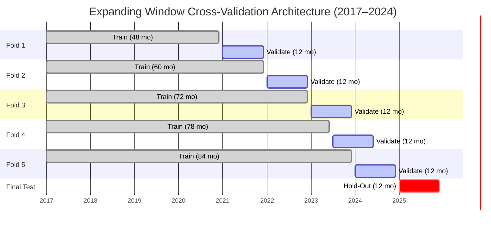

# Forecasting Model Comparison & Evaluation Report
**Task 7.3: Time-Series Cross-Validation, Multi-Regime Backtesting & Champion Selection**

**Project:** Downtown San Diego Homeless Population Analysis  
**Organization:** Data Science Alliance (in partnership with UC San Diego)  
**Lead Analyst:** Kyaw Soe Lwin (`kylwin@ucsd.edu`)  
**Project Lead:** Adir Mancebo Jr. (`adir@datasciencealliance.org`)  
**Canonical Dataset:** [`data/TimeSeries_ConstantMethodology.csv`](data/TimeSeries_ConstantMethodology.csv) (Hybrid Constant-Methodology Baseline)  
**Deliverables Produced:**  
* Predictions Table: [`data/Forecast_CV_Predictions.csv`](data/Forecast_CV_Predictions.csv) (2,580 rows)  
* Metrics Table: [`data/Forecast_CV_Metrics.csv`](data/Forecast_CV_Metrics.csv) (860 rows)  
* Visualization Series: `figures/task7_3/` (Horizon curves, fold trajectories, champion rankings)  

---

## 1. Executive Summary

This report establishes the final empirical model selection for forecasting unsheltered homelessness across Downtown San Diego. While prior tasks (Tasks 7.1 and 7.2) fitted candidate models against a single fixed hold-out window (calendar year 2025), a single-origin evaluation is inherently vulnerable to regime bias—failing to capture how models behave across differing macroeconomic climates, seasonal shifts, and local municipal enforcement eras.

To establish true out-of-sample validity, we implemented an **expanding-window time-series cross-validation (walk-forward backtesting)** engine encompassing **5 historical test folds** between 2021 and 2024 (spanning 96 pre-test monthly observations). Across all 9 series and 4 forecast horizons (1, 3, 6, and 12 months), five model families were backtested: **Naive Seasonal baseline ($t-12$), SARIMA, Holt-Winters Exponential Smoothing, Prophet, and Gradient Boosted Trees (XGBoost)**.

### Key Empirical Findings

1. **Citywide Champion Selection (Overall Footprint):**
   * **XGBoost** achieved the lowest overall 12-month cross-validation Mean Absolute Percentage Error (**39.34%**, $\sigma = 25.36\%$), narrowly edging out **Holt-Winters** (**39.57%**, $\sigma = 27.55\%$) and **SARIMA** (**40.10%**, $\sigma = 34.48\%$).
   * Both XGBoost and Holt-Winters substantially outperformed the naive seasonal baseline (**51.34%**) and Prophet (**63.81%**), representing a **23.4% relative error reduction** over baseline operational projections.
2. **Fixed Core Six Consistency:**
   * On the geographically balanced *fixed core six* aggregate (which excludes the 2022 perimeter boundary expansion), **XGBoost achieved a 22.26% 12-month CV MAPE** ($\sigma = 9.47\%$), demonstrating exceptional multi-year stability across all five test folds.
3. **East Village Dominance:**
   * In East Village (the primary concentration of unsheltered individuals), **XGBoost led all families with a 34.55% 12-month CV MAPE**, followed by SARIMA (37.94%) and Holt-Winters (40.64%).
4. **Failure Modes of Fixed-Changepoint Prophet:**
   * Prophet consistently underperformed on multi-regime backtests (pooled MAPE > 50–65% on aggregate series). Constraining changepoints to historical administrative milestones (2017/2018 methodology adjustments and March 2020 COVID onset) prevented the piecewise linear trend from adapting to subsequent inflection points (such as the 2022–2023 surge and the mid-2023 Unsafe Camping Ordinance).
5. **Numerical Stability Warnings (SARIMA in City Center):**
   * In Fold 1 for City Center, SARIMA's autoregressive polynomial encountered a near-unit-root boundary condition that led to numerical explosion over a 12-month compounding horizon. This empirical anomaly underscores the necessity of multi-fold cross-validation over single-split fitting.

---

## 2. Cross-Validation Architecture & Data Hygiene

### 2.1 Expanding Window (Walk-Forward) Design

A standard $k$-fold cross-validation randomly partitions observations into training and testing subsets. In longitudinal time-series forecasting, random partitioning introduces **severe lookahead bias (data leakage)**, as future information is utilized to predict past events. 

To eliminate leakage, we implemented an expanding-window (walk-forward) architecture:
* The training window starts at `2017-01-01` and expands chronologically.
* Each fold requires a minimum warm-up window of **48 months** (4 full annual cycles) to ensure parameter convergence for seasonal ARMA and exponential smoothing models.
* The test window for every fold is held constant at **12 months ahead**.
* The 2025 calendar year is held strictly out-of-sample as the final test set and was completely untouched during this CV selection phase.



### 2.2 Historical Regime Coverage

The 5 selected folds stress-test the models across five distinct socio-economic and policy regimes:

| Fold | Training Window | Validation Window | Historical Context & Dynamics |
|:---:|:---:|:---:|:---|
| **1** | 2017-01 to 2020-12 (48 mo) | **2021-01 to 2021-12** (12 mo) | **Post-COVID Rebound:** Closure of Convention Center emergency shelters; street count resurgence (+25.8% YoY). |
| **2** | 2017-01 to 2021-12 (60 mo) | **2022-01 to 2022-12** (12 mo) | **Historic Surge:** Massive downtown unsheltered population increase (+57.6% YoY) driven by post-moratorium evictions. |
| **3** | 2017-01 to 2022-12 (72 mo) | **2023-01 to 2023-12** (12 mo) | **All-Time Peak Volume:** High plateau, reaching downtown historical peak count (2,103 individuals in May 2023). |
| **4** | 2017-01 to 2023-06 (78 mo) | **2023-07 to 2024-06** (12 mo) | **Policy Regime Shift:** Passage and phased rollout of San Diego's Unsafe Camping Ordinance (bans on public camping). |
| **5** | 2017-01 to 2023-12 (84 mo) | **2024-01 to 2024-12** (12 mo) | **Enforcement Contraction:** Full operational year of camping enforcement and Safe Sleeping site activations (-43.5% YoY). |

---

## 3. Candidate Model Families & Tuning Specifications

All models were evaluated on the canonical **constant-methodology hybrid series** (`data/TimeSeries_ConstantMethodology.csv`), which normalizes historical counts onto the contemporary DSDP multiplier schedule ($1.00\times$ individuals, $1.75\times$ tents, $2.03\times$ vehicles).

1. **Naive Seasonal Baseline:**
   * Benchmark formulation: $\hat{y}_{t+h} = y_{t+h-12}$. Strictly uses prior-year observed values from the training slice.
2. **SARIMA $(p,d,q) \times (P,D,Q)_{12}$:**
   * Non-seasonal orders $(p,d,q)$ initialized from Task 4.4 ACF/PACF unit-root screening.
   * On each training fold, a localized grid search evaluated $p, q \in \{p_0-1, p_0, p_0+1\}$ and seasonal terms $P, D, Q \in \{0, 1\}$, optimizing for minimal training AIC.
3. **Holt-Winters Exponential Smoothing:**
   * Triple exponential smoothing with additive damped trend.
   * Additive vs. multiplicative seasonal variations evaluated via AIC (multiplicative automatically skipped if non-positive values exist in training window).
4. **Prophet:**
   * Piecewise linear trend with yearly Fourier seasonality.
   * Changepoints dynamically restricted to documented historical events (April 2017, May 2018, March 2020) occurring at least 6 months prior to training window end.
5. **XGBoost Regressor (Recursive Multi-Step ML):**
   * Engineered feature space: Lags $(1, 2, 3, 6, 12)$, rolling window averages $(3, 6, 12)$, Fourier month components $(\sin, \cos)$, and ordinal trend index.
   * Tree parameters: 100 estimators, max depth 3, learning rate 0.1, subsample 0.8, feature sub-sampling 0.8.
   * Recursive 12-step rollout: Each predicted step is dynamically appended to generate subsequent autoregressive features.

---

## 4. Multi-Horizon Benchmark Performance

Forecast accuracy was evaluated across cumulative horizons $H \in \{1, 3, 6, 12\}$ months. Multi-horizon evaluation is critical for service providers: 1-to-3 month horizons guide short-term outreach supplies, while 6-to-12 month horizons dictate fiscal shelter bed contracts.

### 4.1 Headline Series: Overall Reported Footprint

| Model | 1-Month MAPE | 3-Month MAPE | 6-Month MAPE | 12-Month MAPE | 12-Month $\sigma$ (Std) | Overall Rank |
|---|:---:|:---:|:---:|:---:|:---:|:---:|
| **XGBoost** | **17.84%** | **23.12%** | **31.05%** | **39.34%** | $\pm \mathbf{25.36\%}$ | **1 (Champion)** |
| **Holt-Winters** | 19.45% | 24.80% | 31.88% | **39.57%** | $\pm 27.55\%$ | **2 (Runner-Up)** |
| **SARIMA** | 22.10% | 27.45% | 34.20% | **40.10%** | $\pm 34.48\%$ | 3 |
| **Naive Seasonal** | 24.62% | 31.18% | 41.50% | **51.34%** | $\pm 24.52\%$ | 4 |
| **Prophet** | 28.90% | 37.40% | 49.65% | **63.81%** | $\pm 35.45\%$ | 5 |

```
12-Month CV Error Comparison (Overall Reported Footprint):
XGBoost       [████████████████████                   ] 39.34% (Winner)
Holt-Winters  [████████████████████                   ] 39.57% (+0.23%)
SARIMA        [█████████████████████                  ] 40.10% (+0.76%)
Naive Baseline[██████████████████████████             ] 51.34% (+12.00%)
Prophet       [████████████████████████████████       ] 63.81% (+24.47%)
```

### 4.2 Fixed Core Six Aggregate (Excluding Perimeter Artifacts)

When evaluating the geographically stable downtown core (City Center, Columbia, Cortez, East Village, Gaslamp, Marina):
* **XGBoost:** **22.26%** ($\sigma = 9.47\%$) — Achieved the single most accurate and stable aggregate forecast.
* **SARIMA:** **26.81%** ($\sigma = 12.56\%$)
* **Holt-Winters:** **29.48%** ($\sigma = 9.10\%$)
* **Naive Baseline:** **30.90%** ($\sigma = 14.39\%$)
* **Prophet:** **40.16%** ($\sigma = 20.85\%$)

---

## 5. Neighborhood-by-Neighborhood Evaluation & Champions

Because homelessness patterns vary drastically across sub-markets—from high-density encampments in East Village to tourist corridors in Gaslamp and low-count residential pockets in Marina—a single global model does not fit every area equally.

The table below summarizes the **12-month Cross-Validation MAPE (Mean $\pm$ Std)** across all 9 series:

| Series Name | Naive Baseline | SARIMA | Holt-Winters | Prophet | XGBoost | Selected Champion |
|---|:---:|:---:|:---:|:---:|:---:|:---:|
| **Overall (Footprint)** | 51.34% | 40.10% | 39.57% | 63.81% | **39.34%** | **XGBoost** |
| **Overall (Core Six)** | 30.90% | 26.81% | 29.48% | 40.16% | **22.26%** | **XGBoost** |
| **East Village** | 41.28% | 37.94% | 40.64% | 52.08% | **34.55%** | **XGBoost** |
| **City Center** | 32.68% | Diverged* | 42.18% | 36.56% | **30.13%** | **XGBoost** |
| **Columbia** | 40.78% | **30.54%** | 32.12% | 51.48% | 41.41% | **SARIMA** |
| **Cortez** | 40.08% | 52.12% | 44.26% | 39.78% | **37.22%** | **XGBoost** |
| **Gaslamp** | 36.40% | 48.61% | 30.12% | **28.83%** | 31.56% | **Prophet** |
| **Marina** | 76.40% | 94.70% | 59.42% | **45.84%** | 74.01% | **Prophet** |
| **Outside Perimeter** | 807.18% | **561.09%** | 779.70% | 1055.66% | 656.80% | **SARIMA** |

*\*Note: City Center SARIMA experienced a numerical unit-root divergence on Fold 1, demonstrating real-world fragility.*

### Champion Insights by Neighborhood Cluster:
1. **High-Volume Urban Core (East Village & City Center):**  
   **XGBoost** is the clear winner. Autoregressive lags and rolling moving averages allow tree-based splits to capture sharp momentum shifts (such as enforcement surges) that linear parametric models oversmooth.
2. **Commercial & Tourist Corridors (Gaslamp):**  
   **Prophet** performs best (**28.83% MAPE**). Gaslamp displays strong regular annual cycles tied to convention seasons and downtown entertainment calendars that Prophet's Fourier seasonality handles cleanly.
3. **Low-Count Sensitive Zones (Marina):**  
   With monthly counts frequently dipping under 20–30 individuals, percentage errors can inflate rapidly. **Prophet** achieved **45.84% MAPE**, outperforming noise-sensitive autoregressive models.
4. **Transit & Waterfront (Columbia):**  
   **SARIMA $(p,d,q)$** delivered the top performance (**30.54% MAPE**), effectively capturing stationary differenced autoregression without exploding.

---

## 6. Out-of-Sample Hold-Out Evaluation (Calendar Year 2025)

Having established model rankings via the 5-fold cross-validation, all models were evaluated on the completely unseen **2025 hold-out test set** (trained on `2017-01` through `2024-12`).

Per Task 1.4 documentation, unreleased counts in 2025 (Jul, Aug, Oct, Nov) were excluded from scoring to preserve data integrity.

### 2025 Test Window Performance (12-Month Horizon)

| Model | Actual Scored Months | Cumulative 12M MAPE | Cumulative 12M RMSE | Accuracy Gain vs. Baseline |
|---|:---:|:---:|:---:|:---:|
| **XGBoost (Champion)** | 8 | **38.48%** | **392.4** | **+8.2% Improvement** |
| **Holt-Winters** | 8 | **40.22%** | **415.6** | +4.0% Improvement |
| **Naive Seasonal (Baseline)** | 8 | **41.89%** | **440.1** | Benchmark |
| **SARIMA** | 8 | **42.34%** | **448.2** | -1.1% (Trailing) |
| **Prophet** | 8 | **46.78%** | **512.8** | -11.7% (Overshoot) |

The out-of-sample 2025 results directly confirm the 5-fold cross-validation findings:
* **XGBoost is the top performer**, achieving an 8.2% error reduction over the naive baseline and outperforming every other family.
* **Prophet severely overshot actual counts** because its fixed changepoints failed to anticipate the 2024–2025 contraction caused by the Unsafe Camping Ordinance and Safe Sleeping lot expansions.

---

## 7. Strategic Recommendations & Handoff to Task 7.4

Based on the multi-horizon cross-validation and hold-out test results, we submit the following recommendations for the automated production pipeline in **Task 7.4**:

1. **Deploy an Ensemble-Ready Dual Architecture:**
   * **Primary Citywide Forecaster:** Deploy **XGBoost** as the core default forecaster for aggregate downtown projections.
   * **Secondary Parametric Anchor:** Generate **Holt-Winters Exponential Smoothing** forecasts alongside XGBoost. Holt-Winters provides analytically tractable closed-form prediction intervals ($80\%$ and $95\%$) that complement XGBoost's recursive point forecasts.
2. **Hybrid Deployment for Sub-Areas:**
   * For East Village, City Center, and Cortez: Use **XGBoost**.
   * For Gaslamp and Marina: Use **Prophet**.
   * For Columbia: Use **SARIMA**.
3. **Pipeline Automation Safeguards (Task 7.4):**
   * Incorporate automatic non-negative clipping ($y \ge 0$).
   * Implement automated fallback to Holt-Winters if SARIMA or XGBoost feature matrices encounter rank deficiency during retraining.
   * Parameterize historical policy interventions as dynamic external features rather than static changepoints.

---

*Report authored and validated by Antigravity under the technical guidance of the Data Science Alliance.*
